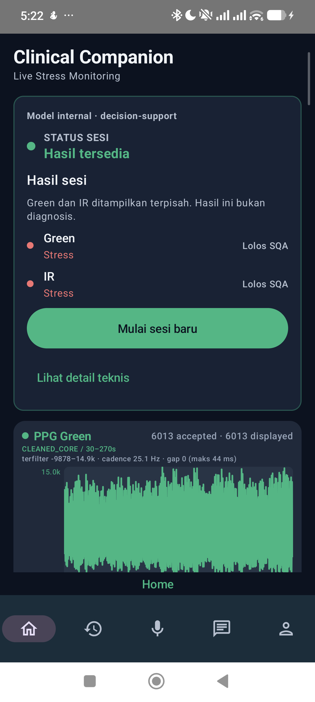
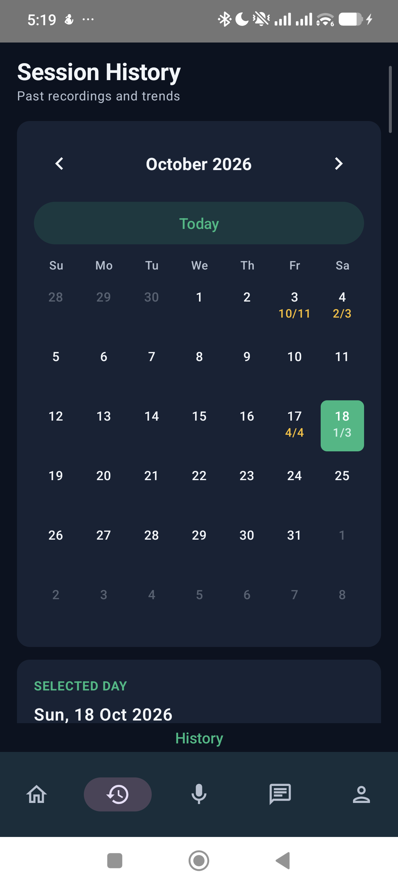
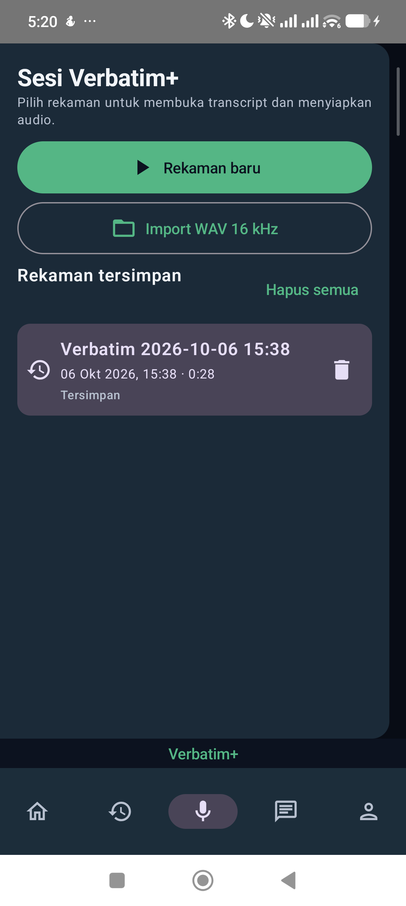
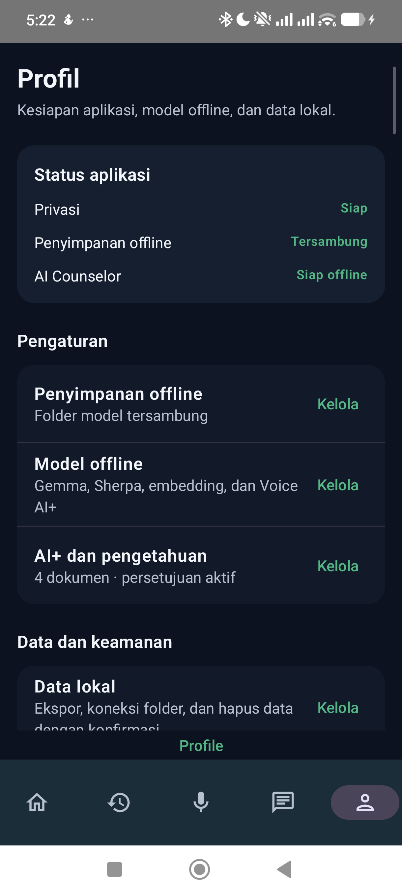
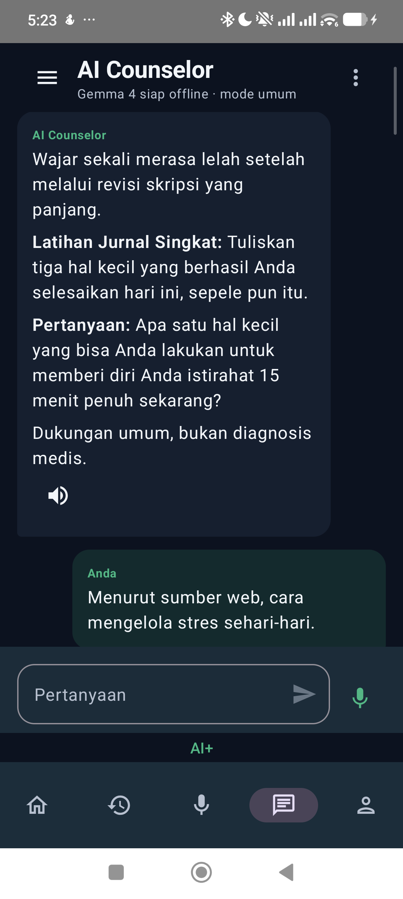
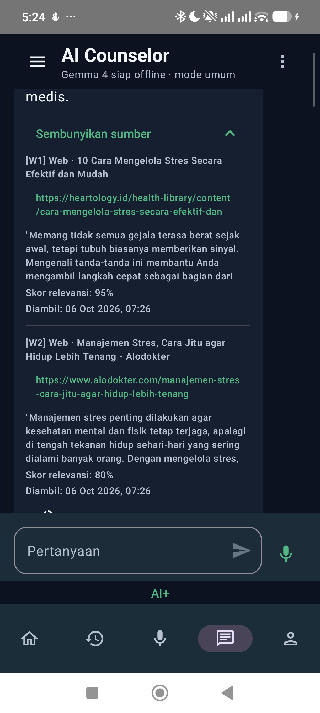

# Stress Detector — Android dan Wear OS

Aplikasi pendamping untuk merekam PPG dari Galaxy Watch dan menjalankan analisis lokal di Android. Hasilnya adalah dukungan keputusan untuk ditinjau, bukan diagnosis, alat klinis tervalidasi, atau pendeteksi kebohongan.

[Unduh Phone v0.1.5](https://github.com/Adrian463588/android-stress-detection/releases/download/android-v0.1.5/app-production-debug.apk) · [Unduh Watch v0.1.1](https://github.com/Adrian463588/android-stress-detection/releases/download/android-v0.1.5/wear-production-debug.apk) · [Semua rilis](https://github.com/Adrian463588/android-stress-detection/releases)

> **Status distribusi:** Phone v0.1.5 adalah prerelease debug untuk evaluasi internal, bukan rilis Play Store. Repository privat; unduhan memerlukan akun GitHub dengan akses. Watch v0.1.1 adalah companion terbaru dan tidak berubah pada rilis Phone v0.1.5.

## Keamanan dan kesiapan publikasi

Repository tetap privat sampai pemilik mengubah visibilitasnya. Audit 18 Oktober 2026 tidak menemukan credential pada reachable Git history atau field nama partisipan eksplisit, tetapi menemukan satu AAR Sherpa 37,6 MB pada commit historis yang masih reachable melalui branch/tag. File itu dihapus dari snapshot kerja melalui perubahan ini; **publikasi tetap diblokir** sampai pemilik menyetujui pembersihan seluruh history dan scan ulang memastikan tidak ada AAR pada refs yang akan dipublikasikan. Penghapusan lewat commit biasa tidak menghapus blob dari commit lama.

- Phone dan Watch memakai R8 minification serta resource shrinking hanya pada `release`; build `debug` dan APK prerelease yang tertaut di atas tetap debug preview.
- Build mengambil Sherpa-ONNX v1.13.4 dari rilis upstream HTTPS ke `app/build/third-party/`, lalu memeriksa ukuran dan SHA-256 tetap sebelum dipakai. `*.aar` diabaikan Git; Samsung Health Sensor SDK tetap perlu disediakan lokal untuk build Watch.
- Workflow `Publication safety` menjalankan pemeriksaan artifact/field identitas pada snapshot kerja dan Gitleaks pada seluruh reachable history. Temuan tidak mencetak nilai atau path sensitif ke log.
- R8 adalah defense-in-depth, bukan jaminan anti-reverse-engineering. Source publik memang dapat dibaca; signing key tidak disimpan di repository. Release yang dibuat tanpa signing key owner tetap unsigned dan tidak boleh dipromosikan sebagai rilis produksi.
- GitHub Secret Scanning saat audit masih nonaktif pada repository privat ini. Setelah repository menjadi public, verifikasi Secret Scanning dan Push Protection di GitHub Settings; workflow tetap menjadi pemeriksaan independen.

Sebelum membuat repository public, jalankan `python scripts/check_publication_safety.py --history` dan Gitleaks full-history scan. Perintah pertama saat ini sengaja gagal karena AAR lama; jangan mengabaikannya atau memakai baseline/allowlist untuk menyatakan repository bersih.

## Ringkasan proyek

Phone menjadi pusat UI, pemrosesan, hasil, riwayat, AI+, dan Verbatim+. Watch menyediakan pengukuran PPG aktual. Model stres di Android memakai satu kanal PPG per model; ECG hanya digunakan sebagai referensi validasi pada pipeline penelitian, bukan input model aplikasi.

Model yang dikemas dikunci ke run **20260916T132736Z**. Green dan IR dievaluasi terpisah; Red hanya diagnostik. Jika data atau kualitas sinyal tidak cukup, aplikasi harus abstain alih-alih mengarang nilai atau hasil.

## Unduhan terbaru

| Aplikasi | Versi | Package | SHA-256 | Unduhan |
| --- | --- | --- | --- | --- |
| Phone | 0.1.5 · versionCode 6 | com.stressdetector | 073531f002e8f9a41fd600a0629b43916331c0bac0ccb68cff7abafae9f838d3 | [APK](https://github.com/Adrian463588/android-stress-detection/releases/download/android-v0.1.5/app-production-debug.apk) |
| Watch | 0.1.1 · versionCode 2 | com.stressdetector | 3ea5fd86c13105244350eab8ea7713cc793df0fbde8d1ba626f3b09a8bc8cf96 | [APK](https://github.com/Adrian463588/android-stress-detection/releases/download/android-v0.1.5/wear-production-debug.apk) |

- [Catatan rilis v0.1.5](docs/releases/android-v0.1.5.md)
- [File checksum rilis](https://github.com/Adrian463588/android-stress-detection/releases/download/android-v0.1.5/SHA256SUMS-0.1.5.txt)
- [Halaman rilis v0.1.5](https://github.com/Adrian463588/android-stress-detection/releases/tag/android-v0.1.5)

Angka checksum di atas dibandingkan dengan digest aset GitHub pada 18 Oktober 2026. Repository privat berarti pengunduh tanpa akses tidak dapat mengambil APK.

### Riwayat versi

| Tag | Phone | Watch | Status |
| --- | --- | --- | --- |
| [android-v0.1.5](https://github.com/Adrian463588/android-stress-detection/releases/tag/android-v0.1.5) | 0.1.5 | 0.1.1 | Prerelease terbaru; internal debug |
| [android-v0.1.2](https://github.com/Adrian463588/android-stress-detection/releases/tag/android-v0.1.2) | 0.1.2 | 0.1.1 | Historis |
| [android-v0.1.1](https://github.com/Adrian463588/android-stress-detection/releases/tag/android-v0.1.1) | 0.1.1 | 0.1.0 | Historis |
| [android-v0.1.0](https://github.com/Adrian463588/android-stress-detection/releases/tag/android-v0.1.0) | 0.1.0 | 0.1.0 | Rilis non-prerelease yang ditandai GitHub sebagai “Latest” |

GitHub masih menandai v0.1.0 sebagai rilis non-prerelease terbaru karena v0.1.5 ditandai prerelease. v0.1.5 tetap APK aplikasi terbaru yang tersedia di repo.

### Instalasi/update

Unduh APK Phone dan Watch dari pasangan di atas. Update APK Phone pada perangkat yang sama tanpa menghapus data:

    adb -s <serial-phone> install -r -d app-production-debug.apk

Gunakan serial yang benar-benar tampil pada `adb devices -l`:

```powershell
$phoneSerial = Read-Host 'Serial ADB Phone'
$watchSerial = Read-Host 'Serial ADB Watch'
adb -s $phoneSerial install -r -d .\app-production-debug.apk
adb -s $watchSerial install -r -d .\wear-production-debug.apk
```

Opsi tersebut memasang ulang secara in-place. Jangan menjalankan uninstall atau pm clear sebagai langkah update. Kedua perangkat harus memakai package dan signing identity yang kompatibel agar Wear Data Layer dapat berkomunikasi.

## Fitur aplikasi

| Menu | Fungsi | Batas bukti terbaru |
| --- | --- | --- |
| **Home** | Memeriksa kesiapan model, izin, dan reachability Watch; merekam sesi stress 5 menit; menampilkan hasil dan kualitas Green/IR. | Paket v0.1.5 lolos 868 JVM tests dan gate build/lint yang tercatat. Replay lulus untuk 7 window Green dan 7 IR. Pada satu sesi baru, Green menghasilkan Normal dan IR abstain karena gap. Full-channel acceptance masih NO_GO karena konflik timestamp diagnostik Red. |
| **History** | Meninjau sesi tersimpan, hasil, kualitas, grafik, serta detail provenance. | Screenshot kalender diambil dari Xiaomi v0.1.5 pada 18 Oktober 2026. Ini bukti tampilan dan navigasi, bukan verifikasi seluruh operasi history. |
| **Verbatim+** | Merekam dan meninjau audio/transkrip/marker; PPG Watch dapat menjadi konteks sesi bila tersedia. Audio tetap harus menunjukkan statusnya sendiri ketika Watch tidak tersedia. | Screenshot daftar sesi diambil dari Xiaomi v0.1.5 pada 18 Oktober 2026. Perekaman audio, STT, dan sinkronisasi Watch tidak diuji dalam smoke test dokumentasi ini. |
| **AI+** | Counselor lokal Gemma, retrieval dokumen, sitasi, dan pencarian web setelah persetujuan/opt-in yang sesuai. | Screenshot v0.1.5 menampilkan percakapan counselor dan panel sumber W1/W2 dalam satu kontrol. Ini membuktikan rendering state yang tersimpan, bukan validitas URL, keberhasilan fetch baru, atau faithfulness jawaban. Corpus bawaan belum tervalidasi. |
| **Profile** | Mengelola izin, model/bundle offline, storage, backup, serta pengaturan terkait. | Screenshot overview diambil dari Xiaomi v0.1.5 pada 18 Oktober 2026. Status yang terlihat bukan verifikasi semua operasi Profile. |

Semua hasil tetap bersifat non-diagnostik. Hasil Stress atau Normal adalah keluaran model pada data sesi tertentu, bukan pengukuran langsung atas perasaan pengguna atau validasi klinis. Green/IR tidak digabung atau dirata-ratakan. Akselerometer dapat digunakan untuk anotasi MADC per window jika sampel Watch aktual tersedia; data gerak bukan fitur model dan tidak memperbaiki waveform.

## Alur pengguna

~~~mermaid
flowchart TD
    A[Home] --> B{Izin, model, dan Watch siap?}
    B -- Tidak --> C[Perbaiki prasyarat / coba koneksi]
    C --> B
    B -- Ya --> D[Rekam PPG aktual selama 5 menit]
    D --> E[Validasi transport, SQA, dan preprocessing]
    E --> F{Window valid tersedia?}
    F -- Tidak --> G[INSUFFICIENT_SIGNAL]
    F -- Ya --> H[Inferensi ONNX Green dan IR secara terpisah]
    H --> I[Hasil aktual dan kualitas]
    G --> J[Simpan / tinjau di History]
    I --> J
    A --> K[Verbatim+ audio dan transkrip]
    A --> L[AI+ lokal / dokumen / web berizin]
    A --> M[Profile, model, izin, dan data]
~~~

## Stack dan arsitektur

- **Bahasa dan UI:** Kotlin, Jetpack Compose, Material 3.
- **Pola aplikasi:** MVVM, ViewModel, coroutines/Flow, unidirectional data flow.
- **Penyimpanan lokal:** Room dan penyimpanan terlindungi sesuai kontrak fitur.
- **Wear:** Wear OS, Google Play Services Wear Data Layer, Samsung Health Sensor SDK.
- **Biosignal:** preprocessing dan SQA/MADC; ONNX Runtime untuk inferensi lokal.
- **AI+:** Gemma lokal/LiteRT-LM, retrieval dokumen lokal, serta gateway web yang terikat consent.
- **Audio:** pemrosesan native untuk fitur akustik dan pipeline speech sesuai artifact/runtime yang tersedia.
- **Build:** Gradle, Android Gradle Plugin, JDK 17.

Batas utama: model stres Android menggunakan PPG. ECG, identitas, metadata sesi, dan kanal saudara tidak menjadi predictor. Data sintetis, fake status, citation buatan, dan prediksi saat sinyal tidak memadai dilarang.

## Struktur repository

    .
    ├── app/          # Aplikasi Phone, Compose UI, ViewModel, penyimpanan dan koordinasi
    ├── wear/         # Aplikasi Watch, sensor dan pengiriman batch PPG
    ├── shared/       # Kontrak pesan dan model data Phone–Watch
    ├── inference/    # Kontrak model, preprocessing dan ONNX runtime
    ├── config/       # Konfigurasi build/pipeline yang digunakan repo ini
    ├── docs/         # Panduan perangkat, release notes, screenshot dan evidence
    ├── gradle/       # Gradle wrapper dan konfigurasi
    ├── build.gradle
    └── settings.gradle

## Galeri UI perangkat

Screenshot berikut diambil langsung dari Xiaomi POCO X7 Pro (`2412DPC0AG`, serial ADB `QSWSEMRKNFZ9LJRC`) pada 18 Oktober 2026. Package `com.stressdetector` yang terpasang adalah Phone v0.1.5, versionCode 6. Ini smoke test navigasi dan rendering pada lima tab; tidak mengubah data aplikasi dan tidak membuktikan seluruh alur fitur, akurasi model, atau penerimaan end-to-end Watch. [Rincian capture dan checksum PNG](docs/evidence/readme-screenshots-xiaomi-20261018.md).

| Home | History |
| --- | --- |
|  |  |

| Verbatim+ | Profile |
| --- | --- |
|  |  |

| AI+ — percakapan | AI+ — satu panel sumber |
| --- | --- |
|  |  |

Catatan pembacaan screenshot:

- Home memperlihatkan hasil tersimpan `Stress` untuk Green dan IR. Ini adalah state lokal yang tampil pada perangkat, bukan bukti bahwa hasil tersebut sesuai kondisi subjektif, benar secara klinis, atau terbebas dari masalah provenance. Lihat [catatan rilis dan batas penerimaan](docs/releases/android-v0.1.5.md) sebelum menafsirkan hasil.
- AI+ menampilkan percakapan tersimpan. Panel sumber memperlihatkan W1/W2, URL, cuplikan, dan skor relevansi yang ditampilkan aplikasi; screenshot bukan verifikasi independen atas kualitas web fetch, sitasi, atau jawaban.
- History, Verbatim+, dan Profile hanya dinavigasi untuk mengambil tampilan. Tidak ada sesi rekaman, penghapusan, ekspor, atau perubahan model dijalankan.

Screenshot historis dari build/perangkat lain tetap tersedia pada [galeri arsip](docs/evidence/README-screenshots-archive.md); screenshot tersebut tidak digunakan sebagai bukti tampilan v0.1.5.

## Status verifikasi dan batas penerimaan

| Area | Bukti yang tersedia | Status |
| --- | --- | --- |
| Unit test Phone/Inference/Shared | 796 + 34 + 38 = 868 JVM tests, tanpa failure/error/skip pada verification receipt v0.1.5. | Lulus pada scope tersebut |
| Static checks dan APK Phone | ktlintCheck, detekt, app/inference production lint, dan assembleProductionDebug dilaporkan lulus. | Lulus pada scope tersebut |
| Watch module pada checkout v0.1.5 | Samsung Health Sensor SDK AAR tidak tersedia; Watch test/compile tidak diklaim lulus di checkout itu. | Belum diverifikasi |
| UI Xiaomi | Pada 18 Oktober, ADB melihat model 2412DPC0AG, Android 16, screen 1220×2712, dan package com.stressdetector v0.1.5/versionCode 6. Lima tab dibuka dan screenshot PNG aktual disimpan; tidak ada tindakan yang mengubah data. | UI/navigation smoke lulus; bukan E2E |
| PPG dan prediksi | Replay satu rekaman lulus 7 window Green + 7 IR. Satu sesi langsung: Green Normal, IR insufficient signal. Red timestamp conflict membuat full-channel acceptance NO_GO. | Partial; bukan validasi klinis |
| AI+ | Layar v0.1.5 menampilkan percakapan Web tersimpan dan daftar W1/W2. Tidak dilakukan pencarian baru atau audit faithfulness pada smoke ini; corpus lokal belum lulus benchmark. | UI display terverifikasi; grounded-web acceptance masih partial |
| Verbatim+ | Daftar sesi dan navigasi UI terlihat pada Xiaomi v0.1.5; tidak ada rekaman/import/delete yang dijalankan. | Audio/STT/Watch end-to-end terbaru belum diklaim |
| Profile dan backup | Overview Profile dibuka pada Xiaomi v0.1.5; aksi operasi data/model tidak dijalankan. | Semua operasi belum diverifikasi pada v0.1.5 |

**Kesimpulan:** repo ini belum memiliki bukti yang mendukung klaim “semua fitur telah lolos end-to-end pada v0.1.5”. Status yang belum lulus atau belum diuji ditampilkan terbuka agar README tidak menjadi klaim pemasaran yang menyesatkan.

- [Catatan rilis v0.1.5](docs/releases/android-v0.1.5.md)
- [Panduan uji perangkat](docs/device-test-guide.md)
- [Evidence capture Xiaomi terbaru](docs/evidence/readme-screenshots-xiaomi-20261018.md)
- [Evidence AI+ historis](docs/evidence/ai-plus-20261005/acceptance.md)
- [Evidence Verbatim+](docs/verbatim-device-acceptance-20261006.md)

## Build dan pengujian

Persyaratan: JDK 17, Android SDK, Gradle wrapper repository, model index dan detector contract dari run 20260916T132736Z, serta Samsung Health Sensor SDK 1.4.1 lokal untuk modul Watch. Gradle mengambil AAR Sherpa yang dipin dari rilis resmi dan menolak ukuran/checksum yang berbeda; artifact tersebut berada hanya di ignored build output. AAR Samsung juga tetap lokal dan tidak disimpan di Git. Distribusi aplikasi yang memakai SDK Samsung memerlukan persetujuan partner Samsung; baca [ketentuan resmi Developer Mode](https://developer.samsung.com/health/sensor/guide/developer-mode.html).

Packaging Phone memerlukan artifact kanonik dari checkout ProsesData yang sesuai. Tanpa index, detector contract, model, atau SDK yang diwajibkan, build harus berhenti dengan jelas; jangan mengganti dependency itu dengan dummy.

Jalankan test dari root repository setelah menyediakan artifact dari run yang
dikunci. Masukkan path root run yang benar-benar ada; script menolak run lain
atau file kontrak yang tidak tersedia:

```powershell
$runRoot = (Resolve-Path -LiteralPath (Read-Host 'Path folder run 20260916T132736Z')).Path
if ((Split-Path -Leaf $runRoot) -ne '20260916T132736Z') {
    throw 'Model production dikunci ke run 20260916T132736Z.'
}
$internalModelIndex = Join-Path $runRoot 'export\internal\internal_model_index.json'
$detectorContract = Join-Path $runRoot 'export\internal\ppg_detector_contract.json'
if (!(Test-Path -LiteralPath $internalModelIndex) -or !(Test-Path -LiteralPath $detectorContract)) {
    throw 'Model index atau detector contract tidak ditemukan pada run yang dipilih.'
}
.\gradlew.bat "-PinternalModelIndex=$internalModelIndex" "-PdetectorContract=$detectorContract" :shared:test :inference:testProductionDebugUnitTest :app:testProductionDebugUnitTest
```

Wear compile/test dan semua pemeriksaan lain harus dicatat terpisah sesuai dependency lokal yang tersedia. Perintah test yang sukses tidak membuktikan sensor fisik, microphone, RAG faithfulness, reminder delivery, atau validasi klinis.

## BDD dan perubahan berbasis spesifikasi

Untuk perubahan produk/dokumentasi, definisikan perilaku yang dapat diperiksa dengan skenario Given/When/Then, implementasikan perubahan terkecil, lalu simpan hasil verifikasi dan batas klaim. Kontrak perubahan README ini dan skenario acceptance ada di [spec README refresh](docs/specs/spec-readme-refresh/SPEC.md).

Referensi workflow:

- [BDD dan contoh Gherkin — Cucumber](https://github.com/cucumber/docs/blob/main/content/docs/guides/overview.md)
- [BMAD Method](https://github.com/bmad-code-org/BMAD-METHOD)
- [OpenSpec SDD](https://github.com/Fission-AI/OpenSpec)
- [RTK — panduan authoring](https://github.com/rtk-ai/rtk)
- [CAVEMAN — panduan authoring](https://github.com/JuliusBrussee/caveman)
- [PONYTAIL — panduan authoring](https://github.com/dietrichgebert/ponytail)

RTK, CAVEMAN, dan PONYTAIL berfungsi sebagai panduan authoring/quality pada repo ini, bukan dependency runtime Android.

## Checklist README

- [x] Overview, batas non-diagnostik, dan model run dijelaskan.
- [x] APK Phone/Watch terbaru, versi, package, checksum, serta riwayat rilis ditautkan.
- [x] Lima menu, fungsi, alur pengguna Mermaid, stack, dan struktur modul diringkas.
- [x] Screenshot nyata yang sudah tersimpan dipakai dengan perangkat, tanggal, dan batas versinya.
- [x] Hasil test dan gap fitur dibedakan; tidak ada klaim semua fitur telah lolos E2E.
- [x] BDD/BMAD/OpenSpec-style acceptance dan sumber GitHub dicatat.
- [x] Screenshot segar untuk Home, History, Verbatim+, AI+, dan Profile dari Xiaomi v0.1.5 dilampirkan; UI smoke dibatasi pada navigasi dan rendering.
- [x] Screenshot yang memuat percakapan AI+ disertakan atas persetujuan pengguna; caption membatasi klaim pada tampilan.
