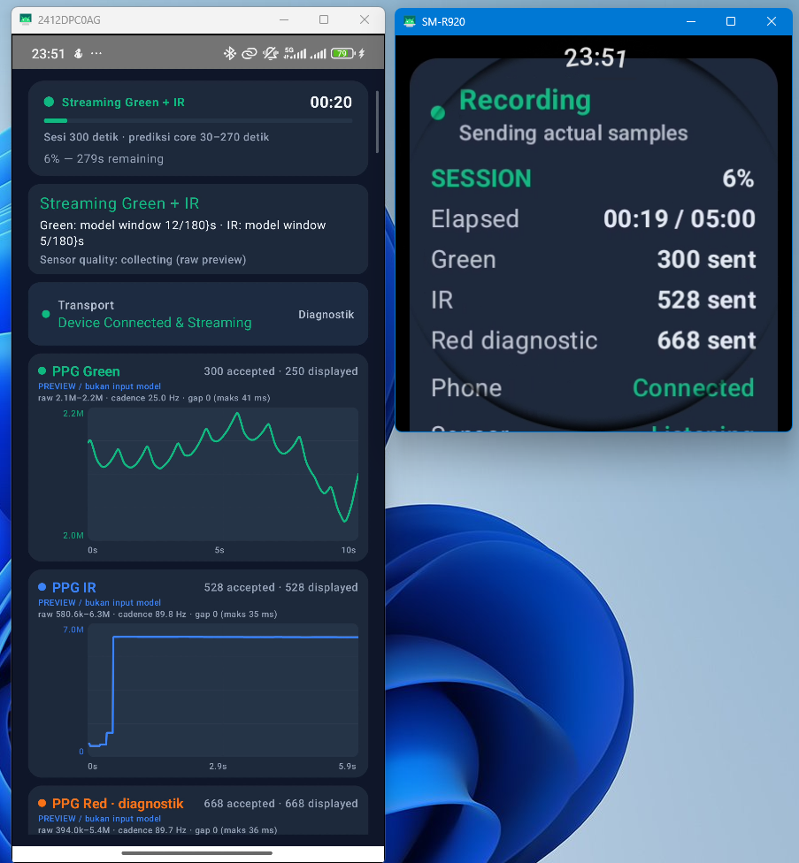
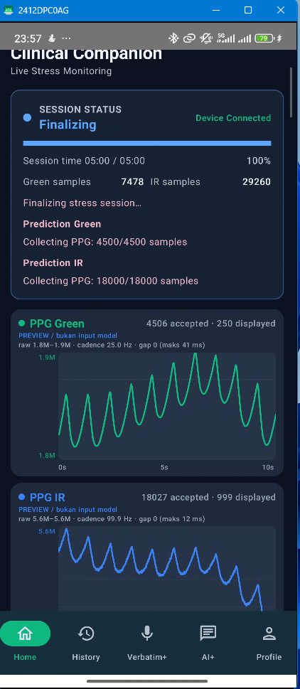
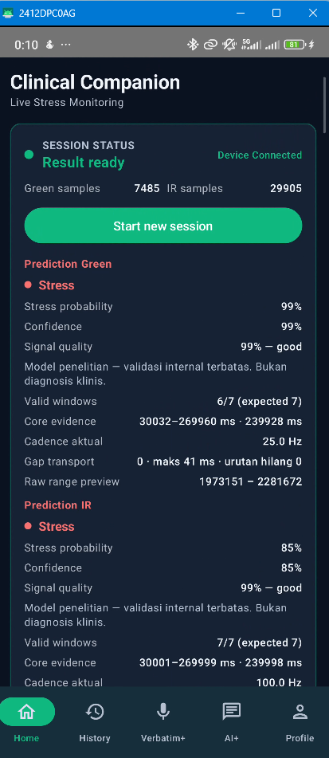
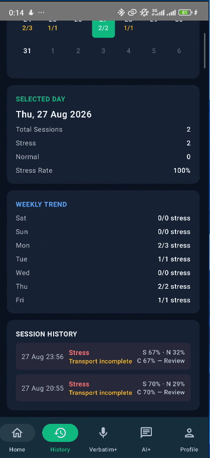
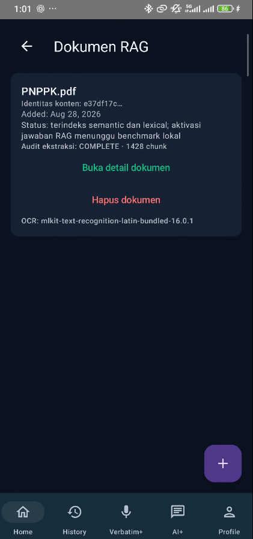
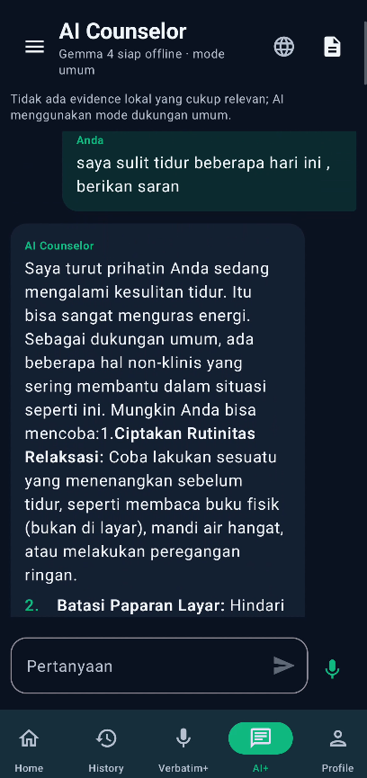

# Stress Detector Android: Phone + Wear

> **Unduh aplikasi untuk dosen/supervisor — versi 0.1.0 (versionCode 1)**  
> [APK Android Phone](https://github.com/Adrian463588/android-stress-detection/releases/download/android-v0.1.0/app-production-debug.apk) · [APK pendamping Wear OS](https://github.com/Adrian463588/android-stress-detection/releases/download/android-v0.1.0/wear-production-debug.apk)  
> SHA-256 Phone: `DB8DAFBC11FE16BD9E86E72995968BF23C7A7B764B27E0501B1C5C419115FA73` · Wear: `4C4A57AFEDB0DF13A5E8AA44E112579346ED1D8C3DB1D6A06ED67DD1273C021D`  
> APK Phone memuat model PPG Green dan IR dari run `20260916T132736Z`. Keduanya adalah debug APK untuk evaluasi internal; output bersifat decision-support, bukan diagnosis. Repository bersifat private; akun GitHub harus memiliki akses untuk mengunduh.

Android project untuk phone companion dan Galaxy Watch. Proyek ini mengintegrasikan pengumpulan data biosignal (PPG) dari smartwatch, inferensi ONNX lokal, serta fitur pendukung keputusan (Verbatim+) dan asisten RAG (AI+ Chatbot).

## Tampilan dan Fitur Utama Aplikasi

Aplikasi ini memiliki beberapa fitur utama yang dirancang dengan antarmuka berbasis Jetpack Compose:

1. **Sesi Perekaman Stres (Verbatim+)
   Perekaman real-time yang terhubung ke Galaxy Watch untuk mengambil data PPG.
   

2. **Pasca-Perekaman & Sinkronisasi**
   Memastikan data aman dan tersinkronisasi sebelum inferensi dijalankan.
   

3. **Hasil Deteksi Stres**
   Menampilkan hasil inferensi model klasifikasi berbasis ONNX secara on-device.
   

4. **Riwayat Deteksi (History)**
   Mencatat hasil deteksi historis untuk evaluasi lebih lanjut.
   

5. **Manajemen Dokumen (AI+ RAG)**
   Pengguna dapat mengelola dokumen lokal sebagai basis pengetahuan tersanitasi untuk AI.
   

6. **AI+ Chatbot Counselor**
   Asisten konseling lokal (on-device LiteRT-LM) yang memanfaatkan dokumen untuk menghasilkan jawaban aman (evidence-gated).
   

Source utama produk tetap [`../PRD.md`](../PRD.md); kontrak UI/runtime Verbatim+ ada di [`../DESIGN.md`](../DESIGN.md) dan [`../EXPERIENCE.md`](../EXPERIENCE.md).

## Modul aktual

| Modul | Tanggung jawab |
|---|---|
| `:app` | Phone app Kotlin + Jetpack Compose, MVVM/UDF, Home, History, Verbatim+, AI+, Profile, Room, SAF, speech/audio, dan koordinasi Watch. |
| `:wear` | Aplikasi Galaxy Watch, tracker PPG Green/IR/Red, koneksi Wear Data Layer, dan status sesi Watch. |
| `:shared` | DTO, codec batch, path pesan, sampling constants, dan kontrak lintas phone–Watch. |
| `:inference` | Validasi manifest/hash/schema, preprocessing, ONNX runtime, dan fail-closed readiness. |

Home stress detection tetap memiliki sesi maksimal 5 menit. Verbatim+ adalah sesi
terbuka yang berhenti melalui `Stop`, error fatal, atau proses Android dihentikan.
Audio/transkripsi tetap dapat berjalan ketika Watch atau PPG unavailable; aplikasi
menampilkan gap/unavailable dan tidak membuat sample, BPM, prediksi, atau transcript
sintetis.

## Verbatim+ UI aktual

- Storage dan speech readiness diproyeksikan dari state nyata yang sama dengan Profile.
- Folder belum tersinkron tidak menghasilkan status sukses palsu; recovery memakai
  `Buka Profile` yang membuka halaman Profile utama secara langsung.
- Saat belum ada sesi, layar tidak menampilkan tab transcript/marker atau panel teknis
  kosong.
- Drawer sesi memakai loading/error/empty state terpisah, judul maksimal dua baris,
  status ringkas, bounded width, dan target hapus minimum 48dp.
- Pada compact/large-font layout, CTA utama tetap reachable dan aksi export/delete
  tidak saling memotong.
- Green dan IR adalah channel inference independen; Red tetap diagnostik. Marker
  fisiologis adalah evidence untuk review, bukan diagnosis atau deception detection.

## AI+ local-first evidence

AI+ memakai LiteRT-LM sebagai generator on-device dan tidak menganggap model
yang belum siap sebagai jawaban yang berhasil. Retrieval evidence berjalan
fail-closed dengan urutan berikut:

```text
APP_RAG → BUNDLED_LOCAL → WEB (consent) → NONE / UNAVAILABLE
```

- `APP_RAG` membaca dokumen lokal terenkripsi yang memiliki provenance valid.
- `BUNDLED_LOCAL` hanya membaca `txt`, `md`, atau `json` yang terdaftar di
  `app/src/main/canonicalAssets/ai/bundled_knowledge_manifest.json` dan lolos
  verifikasi checksum. Manifest saat ini berstatus `EMPTY` karena tidak ada
  corpus konseling berlisensi yang benar-benar tersedia; tidak ada dataset
  training biosignal, log, metadata partisipan, atau dokumen engineering yang
  dipromosikan menjadi corpus chatbot.
- `WEB` hanya aktif setelah consent eksplisit. Query hanya berasal dari
  pertanyaan pengguna yang telah disanitasi; persona, riwayat stress, session
  ID, dan konteks privat tidak dikirim. URL HTTPS publik, batas halaman,
  timeout, dan citation divalidasi sebelum model menerima evidence.
- `NONE` menampilkan `UNAVAILABLE` dan tidak memanggil generator untuk
  pertanyaan yang membutuhkan evidence. Tidak ada citation, jawaban, atau
  status sukses yang dibuat-buat.

Pesan menyimpan source tier, path/URL, checksum, provenance, dan waktu
retrieval. UI menampilkan sumber aktif sebagai `Dokumen lokal`, `Dataset
bawaan`, atau `Web`; error teknis berada pada recovery card terpisah dari
bubble jawaban. Pertanyaan dukungan non-evidence boleh memakai `GENERAL_SAFE`
dengan disclaimer. Kontrak ini mengikuti [LiteRT-LM Kotlin Conversation API](https://github.com/google-ai-edge/LiteRT-LM/blob/main/docs/api/kotlin/getting_started.md),
[Android app architecture](https://developer.android.com/topic/architecture),
dan pembatasan SSRF dari [OWASP](https://cheatsheetseries.owasp.org/cheatsheets/Server_Side_Request_Forgery_Prevention_Cheat_Sheet.html).

## AI+ Reminder

AI+ Reminder adalah fitur opt-in yang membuat paling banyak satu pengingat untuk
satu sesi stress yang valid. Planner dan generator memakai LiteRT-LM lokal; teks
dibuat saat worker berjalan agar tetap memakai sesi valid terbaru. Nama display
dan payload reminder disimpan melalui encrypted storage, sedangkan Room hanya
menyimpan metadata dan provenance. Raw PPG, transcript penuh, dan dokumen RAG
tidak masuk ke notifikasi.

Reminder hanya aktif setelah consent AI+ Reminder dan consent counseling diberikan,
nama (opsional) disimpan, model lokal siap, serta izin notifikasi tersedia. Model
tidak boleh menghasilkan recurrence, waktu lampau, waktu lebih dari 48 jam, klaim
diagnosis, atau klaim tugas grounding yang tidak tercatat. Output invalid atau
model/permission/sesi tidak siap menghasilkan status `UNAVAILABLE`/`FAILED`, bukan
pesan pengganti.

WorkManager menjadwalkan pekerjaan secara persisten dan bersifat perkiraan; Android
dapat menunda eksekusi. Notifikasi memakai channel stabil, `VISIBILITY_PRIVATE`,
`publicVersion` yang tidak membocorkan isi sesi, dan PendingIntent immutable yang
hanya membawa `reminderId` menuju AI+. Permission notifikasi diminta ketika user
mengaktifkan reminder dan tidak menghalangi monitoring PPG.

### Live preview PNG

Screenshot PNG reminder dari perangkat nyata belum dapat diterbitkan pada checkout
ini. Pada satu percobaan manual, `adb install -r -d` berhasil memasang APK
research ke `QSWSEMRKNFZ9LJRC` (`2412DPC0AG`) dan `MainActivity` berhasil dibuka.
Percobaan reinstall berikutnya melalui Gradle ditolak Android dengan
`INSTALL_FAILED_USER_RESTRICTED`; pada verifikasi terakhir `adb devices -l` juga
tidak menampilkan serial tersebut. Bundle Sherpa belum tersedia, instrumented
model-parity belum menghasilkan receipt, permission notifikasi masih disabled,
dan belum ada sesi PPG nyata yang memvalidasi delivery reminder. Status live
preview tetap **BLOCKED**. Tidak ada gambar sintetis, dummy, placeholder, atau
screenshot buatan yang ditambahkan sebagai bukti.

Kontrak dan state machine lengkap berada di
[`docs/specs/spec-ai-reminder/SPEC.md`](docs/specs/spec-ai-reminder/SPEC.md).

Historical device gate (2026-09-08): APK research pernah dibuild untuk
validasi handshake, tetapi variant tersebut sudah tidak menjadi target demo.
Catatan ini dipertahankan sebagai evidence historis; acceptance aktif memakai
production-only pair di bawah.

### Force-close and stress UI smoke — 2026-09-19/20

The latest ADB enumeration found phone `QSWSEMRKNFZ9LJRC` and Watch
`192.168.0.5:35999`. Production debug APKs were built from the run-scoped
internal index
`../data/artifacts/runs/20260916T132736Z/export/internal/internal_model_index.json`
and installed in-place with `adb install -r -d`; no uninstall or `pm clear` was
used. Phone SHA-256:
`4b6f11f6d2bf957de39f960dfd3eac3904251010b50ad81da8ed179b17e6ce05`. Watch
SHA-256:
`75b10402e2885e9655d61a7be99a83b541032db9db47df50a0a070df7f0f0e75`.

The phone launched, reached `APP_REACHABLE`, started Home stress detection, and
remained alive through Stop. Actual PPG Green/IR batches were visible during a
streaming run; a separate no-data run remained explicit and did not generate
synthetic samples or predictions. The historical
`research_holdout_access_forbidden` entries in the crash buffer occurred before
the 00:10:18 APK update. Any later crash entries for
`com.stressdetector.research` belonged to the stale research package removed
during cleanup, not the production pair. This is smoke evidence only; it does
not claim five-minute clinical validation or complete permission/reconnect
coverage.

PNG evidence is stored in the repository root under `docs/evidence/`:
`android_stress_home_reachable_20260919.png`,
`android_stress_monitor_stop_20260919.png`,
`android_stress_monitor_ppg_20260919.png`,
`android_ai_model_unavailable_20260919.png`, and
`android_profile_from_ai_20260919.png`.

Pada acceptance production 2026-09-20, sesi Home mencapai auto-complete lima
menit dan menerima `Green=5700` serta `IR=7273` sample aktual. Finalisasi tetap
fail-closed sebagai `Sinyal tidak cukup` karena core Green berakhir lebih awal
(`core_end_early`, `228373 ms`); tidak ada prediksi atau sample sintetis yang
disimpan. Ini adalah bukti timer/transport dan signal gate, bukan klaim sesi
valid atau clinical validation.

## Build dan verifikasi lokal — production-only

Jalankan dari folder ini:

```powershell
.\gradlew.bat :shared:test :inference:testProductionDebugUnitTest `
  :app:testProductionDebugUnitTest :wear:testProductionDebugUnitTest `
  "-PinternalModelIndex=..\data\artifacts\runs\20260916T132736Z\export\internal\internal_model_index.json" `
  "-PdetectorContract=..\data\artifacts\runs\20260916T132736Z\export\internal\ppg_detector_contract.json"
.\gradlew.bat :app:ktlintCheck :app:detekt :wear:ktlintCheck :wear:detekt `
  :app:lintProductionDebug :wear:lintProductionDebug `
  "-PinternalModelIndex=..\data\artifacts\runs\20260916T132736Z\export\internal\internal_model_index.json" `
  "-PdetectorContract=..\data\artifacts\runs\20260916T132736Z\export\internal\ppg_detector_contract.json"
.\gradlew.bat :app:assembleProductionDebug :wear:assembleProductionDebug `
  "-PinternalModelIndex=..\data\artifacts\runs\20260916T132736Z\export\internal\internal_model_index.json" `
  "-PdetectorContract=..\data\artifacts\runs\20260916T132736Z\export\internal\ppg_detector_contract.json"
```

Production memakai satu-satunya `internalModelIndex` yang diizinkan:
`20260916T132736Z`. Build gagal jika index hilang, run ID berbeda, schema
internal tidak valid, checksum artifact tidak cocok, atau model berstatus
research candidate.

Compose drawer test pada perangkat/emulator:

```powershell
.\gradlew.bat :app:connectedDebugAndroidTest `
  '-Pandroid.testInstrumentationRunnerArguments.class=com.stressdetector.mobile.ui.screens.UnifiedSessionSidebarTest'
```

Test tersebut memeriksa layout compact dengan judul sesi panjang, state folder
belum terhubung, CTA Profile, dan status artifact. Fixture hanya untuk pengujian
layout; runtime tidak menggunakan fake, mock, dummy, placeholder, atau data sintetis.

## Deployment aman

Pasang APK tanpa menghapus data aplikasi:

```powershell
adb -s <phone-serial> install -r -d app/build/outputs/apk/production/debug/app-production-debug.apk
adb -s <watch-serial> install -r -d wear/build/outputs/apk/production/debug/wear-production-debug.apk
```

Phone dan Watch harus sama-sama memakai package `com.stressdetector`. Sebelum
acceptance, verifikasi serial, package, launch, crash log, APK checksum, dan
model run. Untuk membersihkan instalasi demo lama, uninstall hanya
`com.stressdetector.research`; jangan uninstall `com.stressdetector`, jangan
gunakan `pm clear`, dan jangan menghapus model/data production.

## Evidence terakhir — 2026-08-27

Smoke dilakukan pada Samsung `RRCN3008VYE` / `SM-G988B` memakai APK debug
terbaru. AI+ berhasil dibuka dan menampilkan state model yang belum tersedia;
tidak ada jawaban/citation/status sukses sintetis.
Evidence UI nyata:


APK debug yang diverifikasi:

| APK | Ukuran | SHA-256 |
|---|---:|---|
| `app/build/outputs/apk/debug/app-debug.apk` | 254,750,144 bytes | `2787928C1A1E9D9E0291D21810EF59D545E93F3595B1154396B44B88CB0CDE58` |
| `wear/build/outputs/apk/debug/wear-debug.apk` | 17,697,960 bytes | `9337D83104E931D3559AECA33CD1BD297534494B4C66F5AA823F35F0A683ACC2` |

| Evidence | Status |
|---|---|
| `:app:test`, `:wear:test`, ktlint, detekt, app lint, debug assembly | PASS pada working tree `2026-08-27` |
| Compose drawer instrumented test | PASS pada `SM-G988B` |
| Verbatim+ recovery, drawer, dan direct Profile navigation | PASS pada perangkat substitusi |
| AI+ local-first resolver, provenance, consent, model-missing fail-closed | PASS pada unit test dan phone smoke |
| Phone target `QSWSEMRKNFZ9LJRC` | BLOCKED: tidak terlihat pada `adb devices` |
| Watch target `192.168.0.8:38805` | BLOCKED: tidak terhubung pada ADB |
| Real microphone, speech bundle, saved-session artifact, dan Watch PPG | Belum di-claim; memerlukan provisioning/session/hardware nyata |

Software gate tidak menggantikan physical phone + Galaxy Watch acceptance. Root
[`../README.md`](../README.md) menyimpan evidence matrix pipeline dan Android terbaru.

## Watch reachability remediation — 2026-09-15

Implementasi terbaru memisahkan diagnosis node dari reachability aplikasi Watch.
`WearConnectionRepository` memakai gateway Data Layer yang dapat diuji, capability
`stress_detector_wear_app` hanya untuk prioritas target, dan probe bounded dengan
nonce delapan byte yang dikorelasikan dengan node sumber. Hanya urutan
`PING_SENT` → `PING_RECEIVED` → `PONG_SENT` → `PONG_ACCEPTED` yang dapat membuka
`APP_REACHABLE`; timeout langsung membebaskan nonce untuk retry. `Coba koneksi`
tidak membuat lease atau memulai sesi.

Home sekarang memakai copy dan CTA yang konsisten untuk `OFFLINE`,
`NODE_DISCOVERED`, `CHECKING`, `APP_REACHABLE`, `DRAINING`, dan
`PROTOCOL_ERROR`. Detail transport tetap progressive disclosure, sementara
target aksi dan semantics accessibility dipertahankan pada minimum 48dp.

### Identitas aplikasi demo

Wear Data Layer hanya mengirim pesan ketika package name dan signing identity
Phone dan Watch sama. Android demo sekarang hanya memiliki satu identity:

| Variant | Phone | Watch |
|---|---|---|
| `production` | `com.stressdetector` | `com.stressdetector` |

Tidak ada APK research yang dapat dibuild atau dipasang dari Android project.
Artifact riset tetap berada di pipeline sebagai evidence historis, bukan sebagai
mode aplikasi atau target demo.

### Build, install, dan bukti perangkat production

Gate yang dijalankan dari `android/` untuk satu-satunya variant production:

```powershell
.\gradlew.bat :app:testProductionDebugUnitTest :wear:testProductionDebugUnitTest :shared:test `
  :inference:testProductionDebugUnitTest `
  "-PinternalModelIndex=..\data\artifacts\runs\20260916T132736Z\export\internal\internal_model_index.json" `
  "-PdetectorContract=..\data\artifacts\runs\20260916T132736Z\export\internal\ppg_detector_contract.json"
```

APK production dibangun dengan model-index run-scoped nyata, bukan index atau
data buatan:

| APK | Package | SHA-256 |
|---|---|---|
| `app/build/outputs/apk/production/debug/app-production-debug.apk` | `com.stressdetector` | `dibuat dari run 20260916T132736Z` |
| `wear/build/outputs/apk/production/debug/wear-production-debug.apk` | `com.stressdetector` | `pasangan package production` |

Kedua APK production dipasang in-place dengan `adb install -r -d`; data, model,
dan package production tidak dihapus. Endpoint wireless Watch bersifat dinamis
dan harus dibaca ulang sebelum acceptance.

Setelah `Coba koneksi` pada Phone, log Watch menunjukkan `PING_RECEIVED` lalu
`PONG_SENT`. Phone kemudian berpindah dari `NODE_DISCOVERED` ke `APP_REACHABLE`
(`Siap`) dan menampilkan CTA `Mulai deteksi`. Ini membuktikan ping/pong aplikasi
terkorlasi, bukan sekadar discovery node.

PPG hanya boleh diklaim dari batch aktual Watch production. Izin sensor harus
diberikan pada **Stress Watch**; tidak ada sampel, BPM, atau prediksi sintetis
ketika izin atau transport belum tersedia.

Endpoint wireless Watch dapat berubah. Selalu baca ulang `adb devices -l` sebelum
instal atau acceptance, lalu pasang APK Phone dan Watch dari flavor yang sama.

## Model assets

Asset inference bukan source file manual. Task `:inference:syncInferenceAssets`
hanya menyalin bundle berstatus `accepted` dari indeks kanonis:

```text
../data/artifacts/export/model_index.json
../data/artifacts/export/{model_version}/stress_{sensor}_fp32.onnx
inference/build/generated/inferenceAssets/models/{model_version}/{sensor}/
wear/libs/samsung-health-sensor-api-1.4.1.aar
```

Jika indeks kosong, tidak lengkap, atau belum `android_ready`, packaging inference
berhenti fail-closed. Adapter produksi tidak membaca fallback flat assets.
