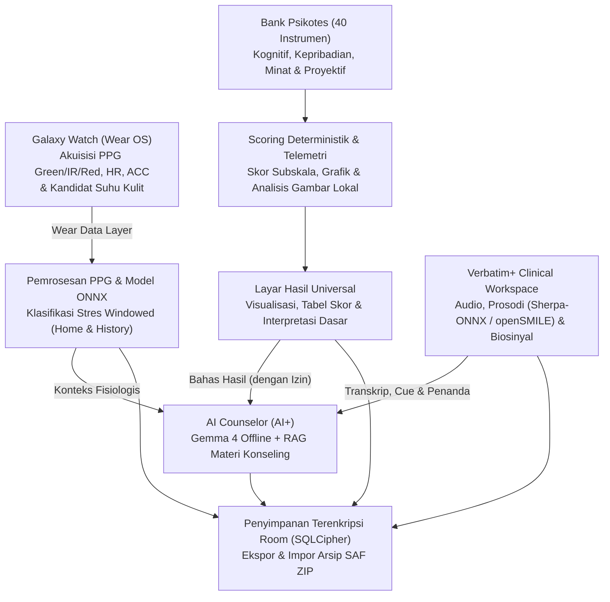
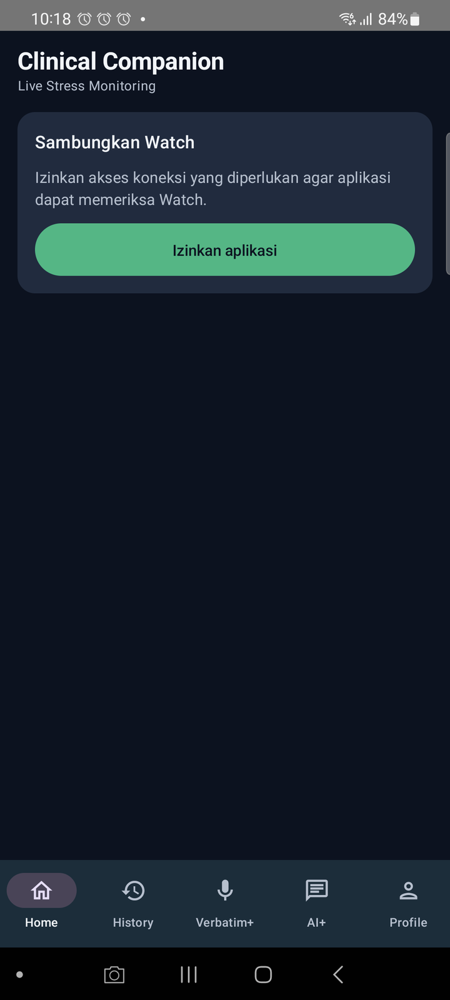
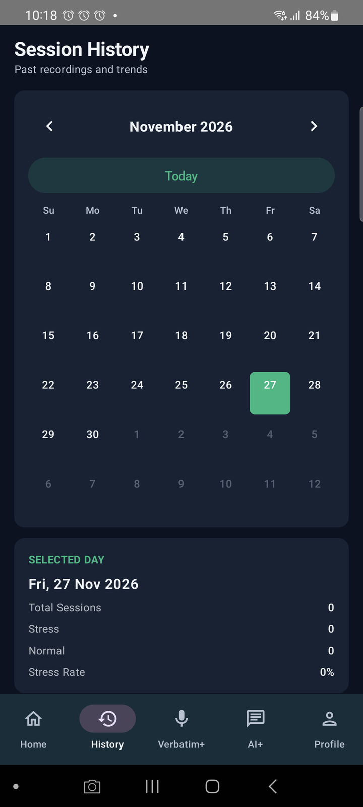
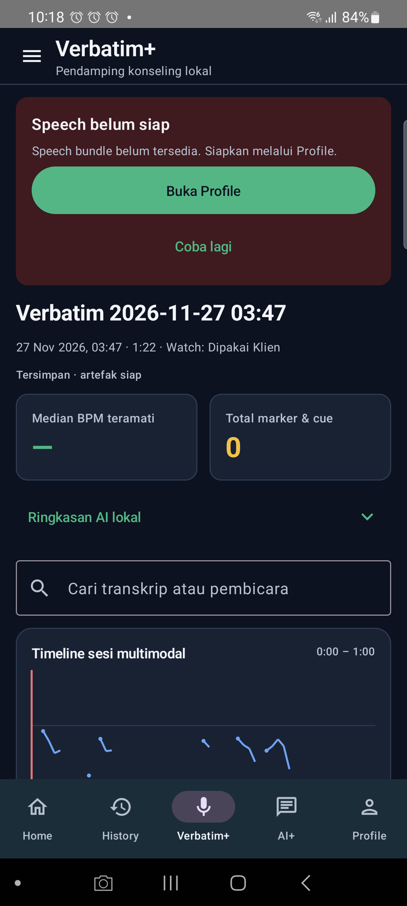
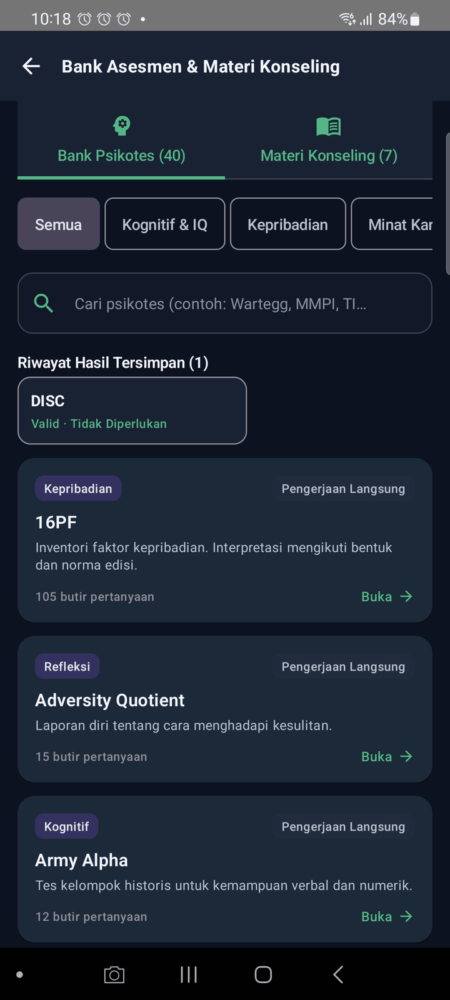
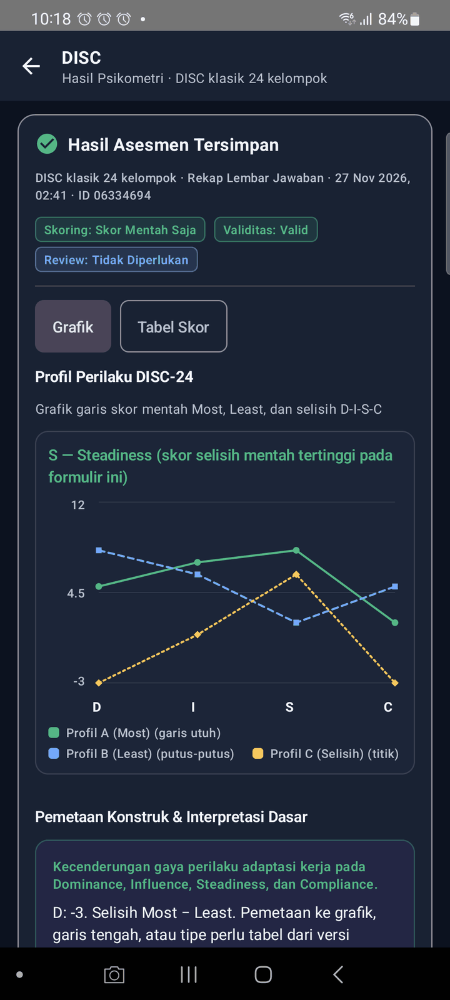
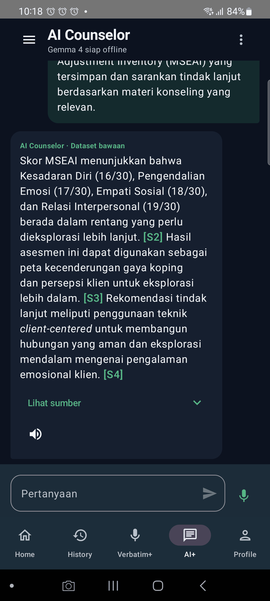
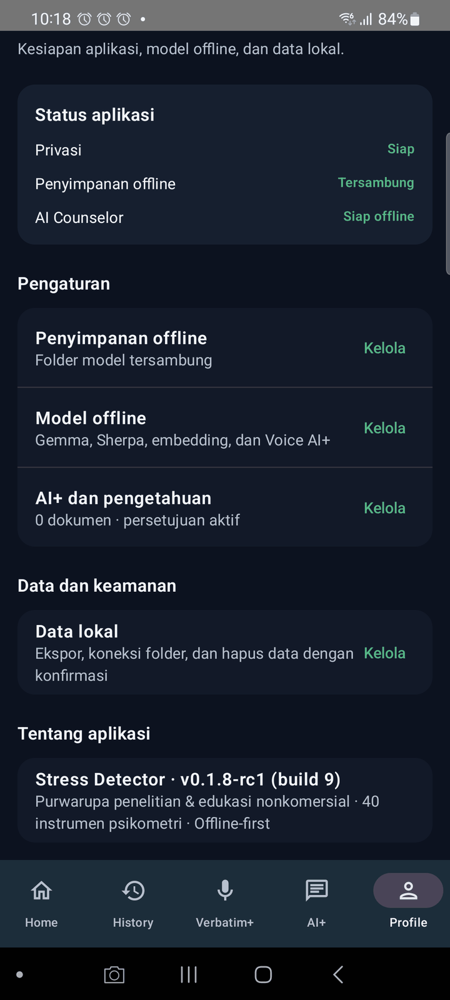

<div align="center">

# Stress Detector

**Clinical Psychological Companion**

Android · Galaxy Watch · Offline AI

[](https://github.com/Adrian463588/android-stress-detection/releases/tag/android-v0.1.8-rc1)
[](#g-installation--getting-started)
[](LICENSE)

<p>
  <a href="https://github.com/Adrian463588/android-stress-detection/releases/download/android-v0.1.8-rc1/stress-detector-android-v0.1.8-rc1.apk">
    
  </a>
  &nbsp;
  <a href="https://github.com/Adrian463588/android-stress-detection/releases/download/android-v0.1.8-rc1/stress-detector-wear-v0.1.2-rc1.apk">
    
  </a>
</p>

[Release Notes](docs/releases/android-v0.1.8-rc1.md) · [Installation Guide](#g-installation--getting-started) · [SHA-256](docs/releases/SHA256SUMS-v0.1.8-rc1.txt) · [Third-Party Notices](THIRD_PARTY_NOTICES.md)

| Komponen | Versi (`versionCode`) | Kompatibilitas Minimum | Ukuran APK | Status Rilis |
|---|---|---|---|---|
| Phone Android (`com.stressdetector`) | `0.1.8-rc1` (`9`) | Android 8.0 Oreo (API 26) | `274.7 MiB` (`288,075,007` byte) | Pre-release (Release Candidate) |
| Galaxy Watch (`com.stressdetector`) | `0.1.2-rc1` (`3`) | Wear OS / Android 9.0 (API 28) | `1.8 MiB` (`1,907,662` byte) | Pre-release (Release Candidate) |

</div>

---

## B. Project Overview

Stress Detector adalah aplikasi Android dan Wear OS pendamping penelitian psikologi yang memadukan pemantauan sinyal fisiologis tubuh, asesmen psikometri, pencatatan sesi konseling, dan asisten kecerdasan buatan (*Artificial Intelligence* / AI) yang berjalan seluruhnya di perangkat tanpa koneksi internet (*offline-first*).

Aplikasi ini dibangun untuk menjawab kendala penelitian di lapangan: instrumen psikotes tradisional umumnya tersebar di kertas atau lembar hitung terpisah, data respons fisiologis jarang tercatat bersamaan dengan sesi wawancara konseling, dan model AI berbasis *cloud* berisiko mengirim data sensitif ke server luar. Dengan menyimpan seluruh proses inferensi dan basis data secara lokal, mahasiswa tingkat awal, peneliti pascasarjana, maupun dosen pembimbing dapat meninjau alur asesmen secara terpadu dalam satu aplikasi purwarupa.

Di dalam ekosistem aplikasi, sensor optik *Photoplethysmography* (**PPG**, metode pengukuran perubahan volume aliran darah menggunakan cahaya LED di pergelangan tangan) dari Samsung Galaxy Watch digunakan untuk mengekstrak *Heart Rate Variability* (**HRV**, variasi jeda antar-detak jantung) sebagai dasar klasifikasi status stres. Di sisi aplikasi ponsel, **40 instrumen psikometri** tersedia lengkap dari pengerjaan soal hingga tampilan grafik skor dan interpretasi deskriptif awal. Seluruh hasil asesmen, rekaman sesi wawancara suara (**Verbatim+**), dan catatan pengguna kemudian dirangkum oleh **AI Counselor (`AI+`)** menggunakan *Retrieval-Augmented Generation* (**RAG**, teknik pencarian dokumen referensi lokal terlebih dahulu agar jawaban AI berdasar pada materi konseling yang tersimpan).

Aplikasi ini dirancang secara eksplisit sebagai **purwarupa pendukung penelitian dan edukasi**, bukan alat diagnosis medis maupun pengganti layanan asesmen atau terapi dari psikolog dan dokter berlisensi.

---

## C. User Flow Diagram

Diagram berikut menggambarkan alur aktual yang telah diimplementasikan dan dapat dijalankan di dalam aplikasi:



---

## D. Technology Stack & Framework

Tabel berikut merangkum seluruh teknologi utama yang benar-benar terpasang dan digunakan pada kode sumber proyek saat ini:

| Teknologi / Komponen | Fungsi pada Aplikasi | Alasan Penggunaan |
|---|---|---|
| Kotlin & Jetpack Compose (`1.9.0`, Material 3) | Bahasa pemrograman utama serta kerangka kerja antarmuka pengguna (*UI*) deklaratif pada Phone dan Wear OS | Memastikan tampilan responsif, konsisten, mendukung aksesibilitas TalkBack dan skalabilitas ukuran huruf, tanpa boilerplate XML yang rumit |
| Android SDK (`minSdk 26`, `targetSdk 34`) & Wear OS (`minSdk 28`, Samsung Health Sensor SDK) | Akses API sistem Android, layanan latar depan (*Foreground Service*), komunikasi jam-ponsel (*Wear Data Layer*), dan pembacaan sensor Galaxy Watch | Diperlukan agar akuisisi PPG dan sinkronisasi sesi tetap berjalan stabil di ponsel maupun smartwatch |
| MVVM & Modular Architecture (`:app`, `:wear`, `:shared`, `:inference`) | Memisahkan logika antarmuka (`ViewModel`), aturan domain, kontrak protokol kawat jam-ponsel, serta pemrosesan model ML | Memudahkan pengujian unit terisolasi di JVM dan mencegah kode logika bisnis tercampur dengan komponen tampilan |
| ONNX Runtime (`1.22.0`) | Mesin inferensi lokal (*inference engine*) untuk menjalankan model klasifikasi stres berbasis fitur sinyal PPG Green/IR | Memberikan eksekusi model numerik deterministik secara luring dengan paritas angka terhadap hasil pelatihan Python |
| LiteRT-LM (`0.13.1`) & Google Gemma 4 E2B (impor lokal) | Menjalankan Large Language Model (*LLM*) lokal serta analisis visi multimodal pada gambar hasil tes proyektif | Memungkinkan penalaran teks maupun gambar grafis (seperti tes Rumah-Pohon-Orang) langsung di perangkat tanpa internet |
| Offline RAG (BM25 + Embedding Lokal + PDFBox-Android) | Mengindeks dan mencari potongan dokumen materi konseling atau buku ajar (`.json` & `.pdf`) di penyimpanan lokal | Memastikan AI Counselor menyertakan sitasi sumber terstruktur (`[S1]`, `[S2]`, dst.) sesuai korpus yang ada di perangkat |
| Sherpa-ONNX (`1.13.4`) & openSMILE (`3.0.2`) | Pengenalan ucapan luring (*Speech-to-Text*), deteksi aktivitas suara (*VAD*), serta ekstraksi fitur akustik prosodi suara (*eGeMAPS*) | Mendukung transkripsi wawancara `Verbatim+` dan pengukuran perubahan ciri suara tanpa mengirim rekaman audio ke cloud |
| Room Database (`2.7.2` + SQLCipher `4.17.0`) & Storage Access Framework (`SAF`) | Menyimpan riwayat sesi stres, hasil asesmen, dan arsip ZIP terenkripsi melalui dialog berkas bawaan Android | Melindungi kerahasiaan data lokal dengan enkripsi AES sekaligus menjaga data tetap portabel untuk diekspor maupun dipulihkan |
| OWASP MASVS Mobile App Hardening | Pemeriksaan integritas APK, deteksi *root*/*debugger*/*hooking* (native C++ JNI), SHA-256 aset katalog, dan penyimpanan kunci perangkat keras (`AndroidKeyStore`) | Mencegah modifikasi aplikasi tidak sah dan memverifikasi keutuhan berkas protokol asesmen luring |

---

## E. Application Features

1. **Real-time PPG Stress Detection (`Home` & `History`)**
   - **Cara kerja & manfaat:** Merekam sesi 300 detik dari smartwatch menggunakan pemrosesan inti 240 detik (`window` 180 detik) untuk memantau kecenderungan kondisi *Normal* atau *Stres*.
   - **Input & Output:** Sinyal PPG per kanal (`ppg_green`, `ppg_ir`; `ppg_red` diagnostik) -> kartu hasil klasifikasi, indikator kualitas sinyal (mengeluarkan *abstain* bila data tidak memadai), dan riwayat kalender per hari.

2. **Galaxy Watch Integration (`:wear`)**
   - **Cara kerja & manfaat:** Aplikasi pendamping di Galaxy Watch mengelola izin sensor, memeriksa ketersediaan Samsung Health Sensor SDK, dan mengirim *batch* sinyal PPG serta detak jantung secara langsung ke ponsel melalui *Wear Data Layer*.
   - **Input & Output:** Pembacaan sensor pergelangan tangan & kontrol sesi dari ponsel -> status keterhubungan, grafik mini, dan indikator baterai/pelacakan di jam.

3. **Psychometric Assessment (`40` Instrumen)**
   - **Cara kerja & manfaat:** Menyediakan 40 alat tes di *Bank Psikotes* yang meliputi ranah kognitif/inteligensi (`CFIT 2A`, `CFIT 3A`, `IST`, `SPM`, `WPT`, `TIU 5`, `TIU 6`, `FRT`, `Army Alpha`), kepribadian & sikap kerja (`16PF`, `EPPS`, `PAPI Kostick`, `MBTI`, `DISC`, `Big Five`, `MMPI`, `MSDT`, `MSAI`, `Enneagram`, `Adversity Quotient AQ-15`, `Pauli`, `Kraepelin`, `MIT`, `VAK`), skrining klinis/eksploratif (`BDI-II`, `SRQ-29`, `CBI`, `CBI-TBI`, `MSEAI`, `ESJ`, `VRT`, `Personality Test`), minat karier (`Holland RIASEC`, `RMIB`, `Kuder`), serta tes proyektif. Seluruh alur dapat dijalankan melalui pengerjaan digital, rekap manual, atau mode simulasi purwarupa tanpa dead-end.
   - **Input & Output:** Jawaban butir soal, entri rekap skor, atau data simulasi -> skor mentah deterministik dan catatan keterbatasan norma per instrumen.

4. **Projective Assessment (`Wartegg`, `Rorschach`, `HTP`, `DAP`, `Baum`)**
   - **Cara kerja & manfaat:** Menyediakan kanvas gambar digital terpadu (`MotionEvent` dengan koordinat historis, pemilihan mode input `Auto / Jari / Stylus`, penghapus, *undo/redo*, serta anotasi lokasi opsional pada `Rorschach`) sekaligus menangkap kinematika proses menggambar.
   - **Input & Output:** Goresan jari/stylus, urutan kotak/panel, judul gambar, dan respons verbal -> metrik observasional (kecepatan, percepatan, *jerk*, kelengkungan, jeda `>= 250 ms`, jumlah revisi, kepadatan ruang, *roughness index*, tekanan/kemiringan stylus yang bernilai `null` bila tidak didukung perangkat), grafik deret waktu, serta deskripsi visi multimodal oleh Gemma 4 E2B lokal.

5. **Scoring, Visualization & Interpretation**
   - **Cara kerja & manfaat:** Setiap asesmen yang selesai otomatis berpindah ke layar hasil spesifik instrumen berdasarkan `resultId` unik.
   - **Input & Output:** Hasil persisten di `KnowledgeBaseDatabase` -> grafik profil khusus instrumen (kurva Most/Least/Selisih `DISC`, kurva interval & kesalahan `Pauli`/`Kraepelin`, radar penunjang `Big Five`/`Holland`, profil klinis `MMPI`, matriks 8 kotak `Wartegg`, panel thumbnail proyektif), tabel skor terstruktur, serta interpretasi dasar luring yang memisahkan angka mentah dari norma klinis resmi.

6. **AI Counselor (`AI+`)**
   - **Cara kerja & manfaat:** Asisten percakapan luring yang mengarahkan strategi respons melalui `AdaptiveCounselingRouter` serta mengambil rujukan dari dokumen basis pengetahuan dan hasil asesmen atau jurnal yang diizinkan pengguna.
   - **Input & Output:** Pertanyaan teks/suara serta referensi `resultId` tersemat -> respons berdasar sumber dengan sitasi `[S1]`, panel *Lihat sumber*, pemutaran suara jawaban (*Text-to-Speech* opsional), serta gelembung rekomendasi tindak lanjut.

7. **Verbatim+**
   - **Cara kerja & manfaat:** Ruang kerja sesi konseling terpadu untuk mencatat wawancara langsung maupun meninjau ulang sesi tersimpan secara terstruktur.
   - **Input & Output:** Mikrofon perangkat dan aliran nadi/sinyal jam (jika terhubung) -> transkrip percakapan berpenanda waktu (*timestamp*), pencarian pembicara/kata kunci, penanda otomatis/manual (*marker & cue*), dan ringkasan sesi lokal.

8. **Audio & Prosody Analysis**
   - **Cara kerja & manfaat:** Memproses audio luring menggunakan *Sherpa-ONNX* untuk transkripsi ucapan dan *openSMILE* (konfigurasi GeMAPS/eGeMAPS) untuk mengekstrak fitur prosodi suara (nada dasar/pitch, energi, rasio jeda).
   - **Input & Output:** Rekaman PCM mikrofon -> grafik sinkron garis waktu audio-nadi dan indikator perubahan fitur vokal yang bersifat deskriptif.

9. **Skin Temperature Monitoring (Status Kandidat)**
   - **Cara kerja & manfaat:** Infrastruktur paket pesan Wear (`WearTemperatureCodec`), mesin pemantauan tren termal (`ThermalMonitoringEngine`), dan migrasi `Room v24 → v25` telah terpasang pada kebijakan default **`CANDIDATE_OBSERVE_ONLY`** (`autoMarkerEnabled = false`).
   - **Input & Output:** Pembacaan suhu kulit & suhu sekitar dari Wear OS (`SKIN_TEMPERATURE_LIVE`) -> penyimpanan seri waktu dan grafik suhu pada peninjauan Verbatim+. *Verifikasi perangkat keras langsung pada Galaxy Watch 5 belum dijalankan (`NOT RUN`).*

10. **Data Management, Export & Import**
    - **Cara kerja & manfaat:** Memungkinkan peneliti mengekspor data sesi Verbatim+, hasil asesmen, dan arsip pengguna ke folder pilihan secara aman, lalu memulihkannya ke perangkat lain dengan verifikasi integritas.
    - **Input & Output:** Pemilihan folder via *Storage Access Framework* (SAF) -> paket arsip `.zip` disertai manifest & checksum SHA-256 (`VerbatimSessionPackageService`, `SafUserBackupService`).

11. **Offline Processing**
    - **Cara kerja & manfaat:** Seluruh pipeline pemrosesan sinyal, inferensi model, pencarian RAG, penyimpanan basis data, dan rendering PDF gambar berjalan 100% di memori lokal perangkat (*zero cloud telemetry*).

12. **Application Security & Privacy**
    - **Cara kerja & manfaat:** Melindungi privasi data peserta penelitian melalui enkripsi Room SQLCipher, `EncryptedSharedPreferences` berdasar `AndroidKeyStore`, isolasi konteks per `participantId`, kontrol pencabutan persetujuan `AI+`, serta deteksi *tampering*/*debugging* runtime.

---

## F. Application Screenshots

Seluruh tangkapan layar ponsel di bawah ini diambil langsung dari APK signed release **`v0.1.8-rc1` (`versionCode 9`)** pada perangkat fisik Samsung Galaxy S20 Ultra (`SM-G988B`, Android 13) dengan data demonstrasi anonim. Tangkapan layar langsung Galaxy Watch saat sesi berjalan belum tersedia (`NOT RUN` karena tidak ada perangkat fisik Galaxy Watch 5 terhubung pada rilis ini).

| Home — PPG Stress Monitoring | Session History |
| :---: | :---: |
|  |  |
| Status kesiapan koneksi Watch dan izin pemantauan PPG *real-time*. | Kalender histori sesi stres harian beserta ringkasan *Normal* dan *Stress Rate*. |

| Verbatim+ Clinical Workspace | Bank Psikotes (`40` Instrumen) |
| :---: | :---: |
|  |  |
| Tampilan ringkasan sesi Verbatim+, pencarian transkrip, serta grafik garis waktu sinyal. | Katalog 40 alat tes psikologi, filter kategori, pencarian, dan riwayat hasil tersimpan. |

| Universal Scoring & Grafik Profil (`DISC-24`) | AI Counselor (`AI+`) Offline RAG |
| :---: | :---: |
|  |  |
| Skor mentah, indikator validitas, grafik profil `Most/Least/Selisih`, serta interpretasi dasar. | Pembahasan hasil asesmen dengan sitasi materi konseling menggunakan Gemma 4 luring. |

| Profile & Tentang Aplikasi (`v0.1.8-rc1`) | Companion Galaxy Watch (`v0.1.2-rc1`) |
| :---: | :---: |
|  | **Belum tersedia (`NOT RUN`)** |
| Pengaturan penyimpanan SAF, kesiapan model offline, data lokal, dan info versi `v0.1.8-rc1 (build 9)`. | Tangkapan layar langsung antarmuka jam belum diambil karena keterbatasan perangkat keras Galaxy Watch saat verifikasi rilis. |

---

## G. Installation & Getting Started

1. **Unduh APK Terbaru:**
   - Unduh [`stress-detector-android-v0.1.8-rc1.apk`](https://github.com/Adrian463588/android-stress-detection/releases/download/android-v0.1.8-rc1/stress-detector-android-v0.1.8-rc1.apk) untuk ponsel Android.
   - *(Opsional, bila memiliki perangkat Wear OS)* Unduh [`stress-detector-wear-v0.1.2-rc1.apk`](https://github.com/Adrian463588/android-stress-detection/releases/download/android-v0.1.8-rc1/stress-detector-wear-v0.1.2-rc1.apk) untuk Galaxy Watch.
   - Cocokkan nilai SHA-256 berkas dengan [`SHA256SUMS-v0.1.8-rc1.txt`](docs/releases/SHA256SUMS-v0.1.8-rc1.txt).

2. **Instal Aplikasi Android:**
   - Buka berkas APK di ponsel Android (izinkan pemasangan dari sumber tepercaya bila diminta), atau perbarui lewat komputer tanpa menghapus data lokal menggunakan ADB (*Android Debug Bridge*):
     ```powershell
     adb install -r -d stress-detector-android-v0.1.8-rc1.apk
     ```

3. **Instal Aplikasi Pendamping Galaxy Watch (Opsional):**
   - Aktifkan *ADB Debugging* pada Galaxy Watch melalui *Settings → Developer options*, hubungkan ke komputer melalui Wi-Fi/Bluetooth ADB, lalu jalankan:
     ```powershell
     adb -s <serial-watch> install -r -d stress-detector-wear-v0.1.2-rc1.apk
     ```

4. **Hubungkan Perangkat & Siapkan Model Offline:**
   - Buka aplikasi di ponsel, berikan izin yang diperlukan saat *onboarding* (`Bluetooth`/`Nearby devices`, `Lokasi`, `Mikrofon`, `Notifikasi`), dan pastikan ponsel serta Galaxy Watch berada dalam akun pairing Wear OS yang sama.
   - Untuk mengaktifkan fitur `AI+` dan transkripsi luring, buka tab **Profile → Penyimpanan offline**, hubungkan folder penyimpanan model lokal Anda yang berisi berkas bobot model terverifikasi (misalnya bundle Gemma 4 dan Sherpa-ONNX).

5. **Jalankan Fitur Utama & Kelola Data:**
   - Gunakan menu **AI+ → ikon menu (⋮) → Asesmen psikometri** untuk mencoba 40 alat tes psikologi beserta layar skor/grafiknya.
   - Gunakan tab **Verbatim+** untuk sesi audio wawancara, tab **Home/History** untuk sesi PPG, dan **Profile → Data lokal** untuk mengekspor atau mengimpor arsip paket data melalui SAF.

---

## H. Security, Privacy & Limitations

Aplikasi menyimpan seluruh data asesmen, audio, dan percakapan di penyimpanan internal terenkripsi (Room SQLCipher + Android Keystore) serta tidak mengirim data partisipan ke cloud eksternal.

| Area Fitur | Status Verifikasi Saat Ini | Keterangan & Batasan Nyata |
|---|---|---|
| 40 Instrumen Psikometri, Visualisasi, Interpretasi Dasar & `AI+` | **Terverifikasi (Software & Perangkat Ponsel)** | Teruji pada `SM-G988B`; skor instrumen tanpa tabel norma resmi ditampilkan apa adanya sebagai **skor mentah/eksploratif**. |
| Kanvas Proyektif Jari & Multimodal Gemma 4 E2B Lokal | **Terverifikasi (Input Sentuh Jari)** | Analisis multimodal membutuhkan berkas model lokal yang diimpor pengguna melalui SAF; bila belum tersedia, sistem kembali ke ringkasan fitur kinematik lokal. |
| Pencatatan *Telemetry* Stylus Aktif (`S Pen`) & Uji Watch 5 Langsung | **Belum Diuji Perangkat Keras (`NOT RUN`)** | Logika pembacaan `MotionEvent.TOOL_TYPE_STYLUS` serta modul `:wear` lulus kompilasi, signing, dan unit test, tetapi belum diuji langsung pada digitizer S Pen fisik atau Galaxy Watch 5. |
| Validasi Norma Populasi Resmi & Persetujuan Ahli Psikologi | **Menunggu Tinjauan Ahli (`BLOCKED`)** | Seluruh keluaran model stres PPG, skor psikotes eksploratif, dan tanggapan AI adalah bahan kajian penelitian (*decision support*), **bukan** diagnosis klinis. |

Rincian lengkap metrik pengujian multi-modul, ukuran APK, sidik jari sertifikat penandatanganan, dan daftar perubahan teknis terdokumentasi di [**Release Notes v0.1.8-rc1**](docs/releases/android-v0.1.8-rc1.md) dan [**SECURITY.md**](SECURITY.md).

---

## I. License & Usage Restrictions

Karya perangkat lunak asli dalam repositori ini didistribusikan di bawah ketentuan khusus [**Research, Educational and Non-Commercial Use Only License**](LICENSE):

- **Penggunaan yang Diizinkan:** Pembelajaran pribadi, kegiatan akademik dan pengajaran, penelitian ilmiah nonkomersial, serta evaluasi purwarupa akademik. Modifikasi dan distribusi ulang secara nonkomersial diperbolehkan selama mencantumkan atribusi kepada penulis asli (**Adrian Syah Abidin**), mempertahankan pemberitahuan hak cipta, dan menerapkan ketentuan lisensi yang sama.
- **Larangan Tegas:**
  1. Dilarang menjual, memonetisasi, menyewakan, atau menggunakan perangkat lunak ini untuk keperluan komersial dalam bentuk apa pun tanpa izin tertulis dari pemegang hak cipta.
  2. Dilarang menggunakan aplikasi ini beserta seluruh keluaran biosinyal, skor psikotes, atau jawaban `AI+` sebagai layanan konsultasi, konseling, asesmen psikologis resmi, diagnosis, maupun terapi profesional terhadap klien atau pasien nyata.
- **Klarifikasi Status Lisensi:** Lisensi khusus ini menjadikan repositori ini berstatus **perangkat lunak riset akademik *source-available*** — **bukan** GPL-3.0 dan **bukan** lisensi *Open Source* yang disetujui oleh *Open Source Initiative* (OSI) karena adanya pembatasan penggunaan komersial dan klinis. Aplikasi disediakan tanpa jaminan validitas klinis.
- **Komponen Pihak Ketiga & Hak Cipta Instrumen Tes:** Pustaka *open-source* pihak ketiga, `openSMILE 3.0.2` (lisensi riset nonkomersial audEERING), SDK milik Samsung/Google, bobot model AI eksternal, serta hak kekayaan intelektual alat tes psikometri penerbit tetap tunduk pada lisensi dan pemiliknya masing-masing sebagaimana dirinci dalam [**THIRD_PARTY_NOTICES.md**](THIRD_PARTY_NOTICES.md).

---

## J. Author

<div align="center">

**Developed by Adrian Syah Abidin**  
Copyright © 2026 Adrian Syah Abidin.

</div>
