# Stress Detector untuk Android dan Galaxy Watch

Aplikasi pendamping yang merekam PPG dari Galaxy Watch dan menghitung hasil stres
secara lokal di HP. Hasilnya adalah **bantuan pengambilan keputusan**, bukan
diagnosis medis.

## Preview pengembangan Verbatim+ v0.1.1

- Waveform amplitudo PCM dan pitch openSMILE F0 terpisah, live dan arsip per 60 detik.
- Marker cue, akustik/prosodi, catatan dan PPG opsional dapat ditinjau dengan bukti serta aksi dengar pada arsip.
- Perbaikan pemotongan diarization, final ASR kosong, antrean VAD dan review pengulangan ASR; teks asli tidak dihapus.
- Trace ikut ZIP serta backup SAF terenkripsi. Arsip lama tanpa trace menampilkan unavailable.
- Bundle speech v4 memakai Whisper untuk teks final Indonesia/Inggris; diarization tetap memakai segmentasi/embedding native, bukan Whisper saja.

[Kontrak, hasil verifikasi dan checklist manual](docs/evidence/verbatim-audio-20261015/acceptance.md).
Belum ada pengujian fisik APK ini; gambar di bawah berasal dari versi historis.
Preview debug internal, bukan klaim akurasi forensik, diagnosis atau pendeteksi kebohongan.

### Riwayat unduhan

- [Unduh Phone v0.1.1 preview](https://github.com/Adrian463588/android-stress-detection/releases/download/android-v0.1.1/app-production-debug.apk).
- [Unduh Galaxy Watch v0.1.1 preview](https://github.com/Adrian463588/android-stress-detection/releases/download/android-v0.1.1/wear-production-debug.apk).
- [Rilis v0.1.1 dan keterbatasannya](https://github.com/Adrian463588/android-stress-detection/releases/tag/android-v0.1.1), [checksum SHA-256](https://github.com/Adrian463588/android-stress-detection/releases/download/android-v0.1.1/SHA256SUMS.txt).
- [Rilis historis Android](https://github.com/Adrian463588/android-stress-detection/releases).
- [Phone dan Watch v0.1.0](https://github.com/Adrian463588/android-stress-detection/releases/tag/android-v0.1.0).

Unduhan repo private memerlukan akun yang diberi akses. Gunakan build Phone dan
Watch 0.1.1 dari rilis yang sama. Source Watch/shared sudah berbeda dari tag
historis 0.1.0; versi companion dibangun ulang, tanpa mengklaim pairing/PPG fisik lulus.

## Evidence historis v0.1.0

### Perbaikan AI+ lokal — 6 Oktober 2026

Pada pengujian 6 Oktober berikut, perubahan development saat itu **belum memperbarui APK pada tautan rilis**.
APK production-debug lokal dipasang in-place pada HP `2412DPC0AG`
(`QSWSEMRKNFZ9LJRC`) tanpa uninstall atau penghapusan data.

- Prompt percakapan, budget dan format daftar diperbaiki. Memori aktif memakai
  kutipan chat, episode relevan, serta tujuan/preferensi yang benar-benar dinyatakan
  pengguna; tidak membuat diagnosis atau ringkasan buatan. Gemma di HP mengingat
  konteks revisi skripsi dan memberi satu latihan journaling serta satu probing.
  Runtime kini mempertahankan spasi/baris baru agar paragraf dan daftar tidak
  menyatu. Judul sumber saja tidak diterima sebagai jawaban.
- Setiap jawaban kini mempunyai satu menu **Lihat sumber**, tertutup secara
  default. Semua rujukan `[W1]`, `[W2]`, metadata dan tautan tampil bersama
  saat dibuka, tanpa tombol lipat berulang per rujukan. Penomoran dan binding
  sumber tidak diubah.
- Retrieval memakai urutan dokumen lokal → dataset bawaan → web berizin.
  Corpus bawaan masih kosong dan belum ada benchmark RAG tervalidasi; jawaban
  yang memerlukan evidence tetap diblokir, bukan diberi sumber buatan.
- Pilihan **Izinkan web otomatis** merupakan opt-in terpisah, dapat dicabut, dan
  menghilangkan dialog per pesan untuk topik publik umum. Pesan pribadi, riwayat
  stres, persona dan dokumen tidak dikirim. Mode manual tetap menampilkan query.
  Pencarian nyata menghasilkan jawaban Gemma dengan sitasi URL; binding sitasi
  tidak membuktikan seluruh klaim sudah didukung kutipan atau tervalidasi klinis.
  Kegagalan evidence tetap ditampilkan jujur lewat recovery ringkas, bukan jawaban buatan.
- History hanya memakai sesi selesai dengan label, probabilitas, dan kualitas
  yang diterima. Reminder tetap opt-in dan non-diagnostik; eligibility dan kanal
  notifikasi diperiksa ulang sebelum publication. Delivery nyata belum dibuktikan.
- Unit test: app **602**, inference **31**, Watch **30**, shared **36** (699), tanpa
  failure. Build APK, ktlint, detekt dan lint production lulus.
- Empat instrumented test UI/query/opt-in dan rollback Room lulus pada smoke
  inference sebelumnya. Enam test Compose pengelompokan sumber lulus pada
  APK final: termasuk bubble chat 320dp/font scale 2, metadata lokal/web,
  callback URL, perubahan sumber, serta state layar yang dibuat ulang.
  Pembatalan saat Gemma berpikir memulihkan composer tanpa balasan terlambat
  pada pengamatan sebelumnya. Pembaruan terakhir: **6 Oktober, 08:04:09 WIB**;
  checksum APK terpasang cocok dengan artifact lokal. Ini bukan klaim semua
  screen, semua ukuran, TalkBack, RAG dan reminder sudah lolos E2E.

Preview rujukan pada APK final, dari percakapan yang tersimpan di HP:

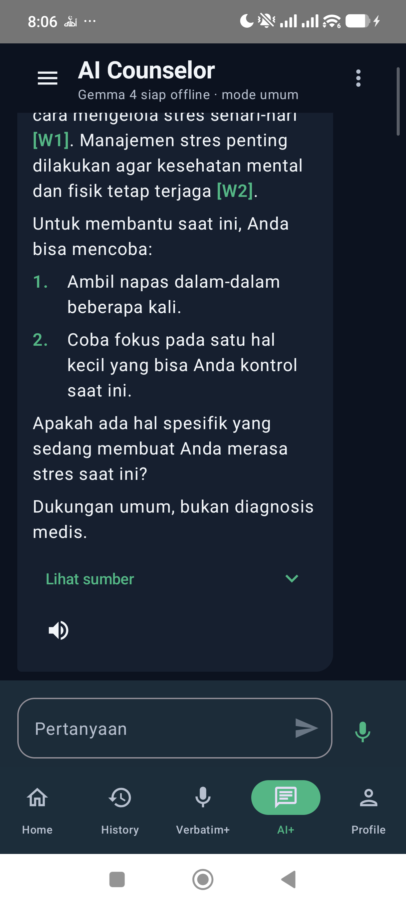

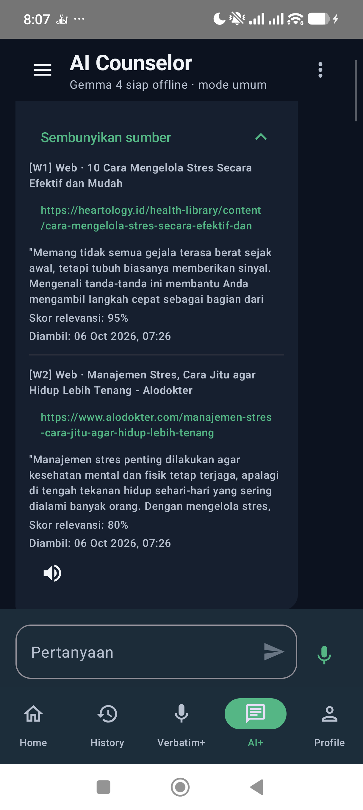

Lihat [evidence pengelompokan sumber](docs/evidence/ai-plus-20261006/source-disclosure.md)
untuk checksum, perintah verifikasi, hasil dan batas pengujian.

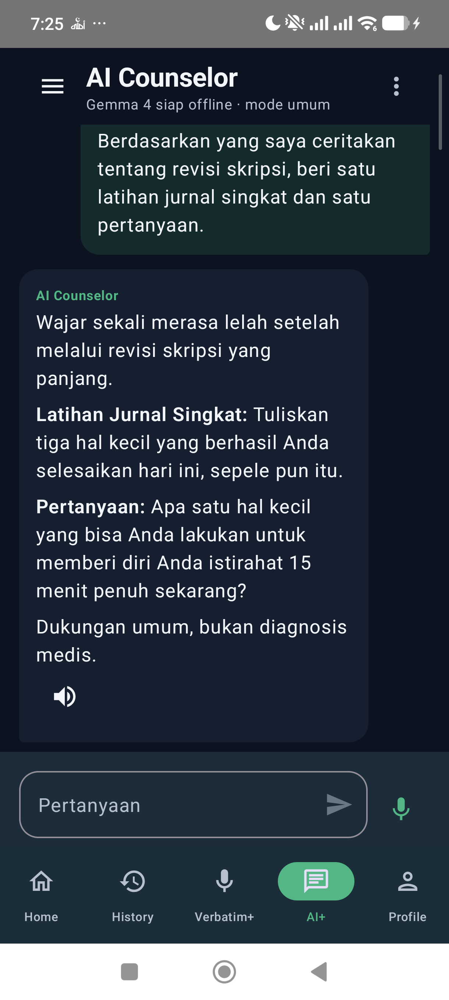

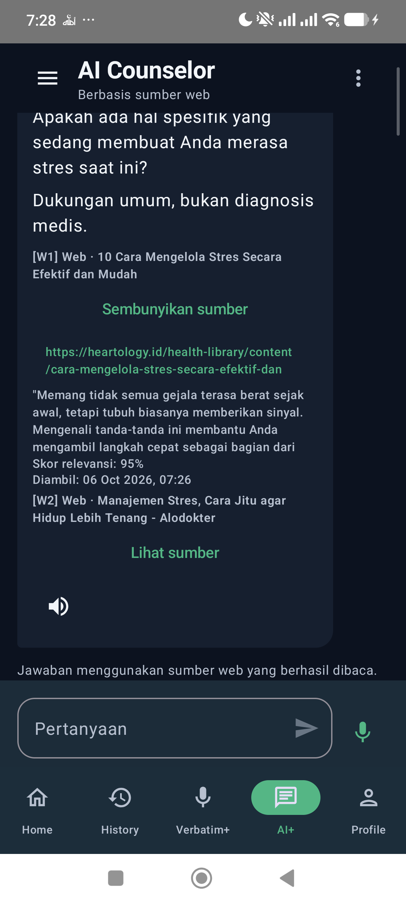

Evidence lengkap dan batas acceptance:
[laporan pengujian AI+](docs/evidence/ai-plus-20261006/acceptance.md).

- **[Unduh APK HP v0.1.0](https://github.com/Adrian463588/android-stress-detection/releases/download/android-v0.1.0/app-production-debug.apk)**
- **[Unduh APK Galaxy Watch v0.1.0](https://github.com/Adrian463588/android-stress-detection/releases/download/android-v0.1.0/wear-production-debug.apk)**

Kedua berkas berasal dari [rilis yang sama](https://github.com/Adrian463588/android-stress-detection/releases/tag/android-v0.1.0).
Instal keduanya: Watch merekam PPG, sedangkan model ONNX berjalan di HP. APK
ini **debug build untuk evaluasi internal**, bukan rilis Play Store. Jika repo
masih privat, unduhan memerlukan akun GitHub yang diberi akses.

> **Sebelum membuka repo atau rilis untuk publik:** pastikan persetujuan partner
> Samsung untuk mendistribusikan aplikasi yang memakai Health Sensor SDK sudah
> diperoleh. Lihat [ketentuan distribusi Samsung](https://developer.samsung.com/health/sensor/guide/developer-mode.html).

Model yang dikemas berasal dari run `20260916T132736Z`. Green menjadi kanal
utama, IR dinilai terpisah, dan Red tidak memiliki model stres. Kualitas sinyal
yang tidak memadai menghasilkan status *sinyal tidak cukup*, bukan prediksi
yang dibuat-buat.

### Cara mencoba

1. Instal APK HP dan APK Watch dari tautan di atas, lalu pastikan kedua perangkat terhubung.
2. Buka aplikasi Watch dan HP; berikan izin sensor serta Bluetooth yang diminta.
3. Di HP, pilih **Coba koneksi**. Mulai sesi saat status Watch menunjukkan siap.
4. Rekam sesi sekitar lima menit. Baca hasil Green/IR dan status kualitas di HP.
   Jika sinyal tidak cukup, perbaiki posisi Watch atau koneksi sebelum mengulang.

Panduan ADB dan pemeriksaan sesi nyata tersedia di
[panduan uji perangkat](docs/device-test-guide.md).

## Apa yang tersedia?

| Bagian | Fungsi |
| --- | --- |
| Home | Koneksi Watch, pemantauan PPG, dan hasil sesi stres. |
| History | Riwayat hasil sesi yang tersimpan. |
| Verbatim+ | Perekaman percakapan dan PPG dalam satu alur; fitur audio tetap dapat digunakan saat PPG tidak tersedia. |
| AI+ | Bantuan berbasis dokumen lokal; sumber web memerlukan persetujuan. Model atau sumber yang belum siap ditampilkan sebagai tidak tersedia. |
| Profile | Pengaturan izin, penyimpanan, dan model lokal. |

Antarmuka memakai Jetpack Compose dan MVVM.
[Tangkapan layar aplikasi](docs/screenshots/) bersifat ilustrasi antarmuka;
bukti pengujian perangkat harus berasal dari sesi aktual.

## Untuk developer

### Struktur

| Modul | Tanggung jawab |
| --- | --- |
| `:app` | UI Compose, ViewModel, penyimpanan lokal, dan koordinasi sesi di HP. |
| `:wear` | Akuisisi PPG dan status sesi di Galaxy Watch. |
| `:shared` | Kontrak pesan dan data lintas HP–Watch. |
| `:inference` | Pemeriksaan kontrak model, preprocessing, fitur, dan inferensi ONNX. |

Model stres hanya memakai PPG. ECG dipakai di pipeline Python sebagai referensi
penelitian, **bukan** input aplikasi. Tidak ada fallback ke data atau model
tiruan ketika sensor, kontrak, atau model tidak tersedia.

Pada sesi Home, Watch mengirim akselerometer Android X/Y/Z yang teramati bersama
batch PPG versi 5. Phone memakainya hanya untuk anotasi MADC per window setelah
validasi sesi dan urutan batch. Data gerak tidak mengubah waveform, fitur model,
atau hasil prediksi; saat sensor/gap tidak memadai, status MADC tidak tersedia.

### Prasyarat build

- Android SDK, JDK 17, dan perangkat/ADB untuk uji fisik.
- Direktori saudara `../data/artifacts/runs/20260916T132736Z/` dari proyek
  ProsesData, berisi `internal_model_index.json`,
  `ppg_detector_contract.json`, dan model ONNX yang dirujuk. Artefak penelitian
  ini **tidak** disimpan dalam repo Android mandiri.

Build sengaja gagal jika artefak run tersebut hilang, berubah, atau tidak cocok.
Tidak ada fallback ke index model global.

### Samsung Health Sensor SDK

Modul Watch memakai Samsung Health Sensor SDK v1.4.1. SDK tidak disimpan di Git;
unduh dari [portal resmi Samsung Developer](https://developer.samsung.com/health/sensor/overview.html).

1. Unduh dan ekstrak SDK dari halaman resmi.
2. Salin `samsung-health-sensor-api.aar` ke `wear/libs/`.
3. Jalankan build seperti biasa. Gradle membaca AAR lokal dari folder tersebut.

Aturan `.gitignore` mengecualikan AAR ini dan folder hasil ekstraksi `1.4.1/`.
Jangan menghapus aturan tersebut atau memasukkan kembali arsip SDK ke commit.

Samsung mensyaratkan persetujuan partner sebelum aplikasi yang memakai SDK
didistribusikan. Developer mode hanya untuk pengujian dan debugging. Baca
[panduan resmi Developer Mode](https://developer.samsung.com/health/sensor/guide/developer-mode.html)
sebelum uji pada Watch.

Jalankan dari direktori `android/` di checkout ProsesData:

```powershell
$runRoot = (Resolve-Path ..\data\artifacts\runs\20260916T132736Z).Path
$index = Join-Path $runRoot 'export\internal\internal_model_index.json'
$detector = Join-Path $runRoot 'export\internal\ppg_detector_contract.json'

.\gradlew.bat --no-daemon "-PinternalModelIndex=$index" "-PdetectorContract=$detector" `
  :app:assembleProductionDebug :wear:assembleProductionDebug
```

Hasil build berada di:

```text
app/build/outputs/apk/production/debug/app-production-debug.apk
wear/build/outputs/apk/production/debug/wear-production-debug.apk
```

Nama variant `productionDebug` adalah nama Gradle; **cakupan model tetap
evaluasi internal**. HP dan Watch memakai package `com.stressdetector` dan
harus ditandatangani dengan identitas yang cocok agar Wear Data Layer bekerja.

### Test dan pemeriksaan statis

Dengan `$index` dan `$detector` dari perintah sebelumnya:

```powershell
.\gradlew.bat --no-daemon "-PinternalModelIndex=$index" "-PdetectorContract=$detector" `
  :shared:test :inference:testProductionDebugUnitTest `
  :app:testProductionDebugUnitTest :wear:testProductionDebugUnitTest `
  ktlintCheck detekt :inference:lintProductionDebug `
  :app:lintProductionDebug :wear:lintProductionDebug
```

Build dan unit test tidak menggantikan uji sesi Watch nyata. Untuk bukti fisik,
periksa perangkat melalui `adb devices -l`, lalu ikuti
[panduan uji perangkat](docs/device-test-guide.md). Jangan memakai data sintetis
sebagai bukti sensor atau menganggap instalasi APK sebagai bukti kualitas prediksi.

### Bukti uji akselerometer Home (3 Oktober 2026)

APK `productionDebug` dipasang ulang in-place pada HP `2412DPC0AG`
dan Watch `SM-R920`. Pada satu sesi
Home aktual, `dumpsys sensorservice` Watch mencatat pendaftaran akselerometer
`40000us` pukul 15:52:41 dan pelepasan listener pukul 15:57:40. Detail hasil
Phone menampilkan MADC Green dan IR masing-masing `7/7` window dengan anotasi
gerak. Ini membuktikan jalur data gerak pada sesi tersebut, bukan akurasi MADC
atau validasi klinis. Pemeriksaan crash buffer tidak menemukan entri baru untuk
Phone/Watch selama sesi tersebut.

Uji ulang pukul 17:44–17:49 menemukan regresi sumber PPG pada sesi lain:
Watch menerima Green 7.511 sampel, IR 8.939, Red 9.004, serta 7.533 sampel
akselerometer. Phone menerima seluruh 8.939 sampel IR dengan `Batch hilang 0`,
tetapi rentang core IR berhenti pada 90.170 ms dan Green pada 252.487 ms
(target core akhir 270.000 ms). Keduanya benar-benar abstain; ini bukan bukti
MADC IR gagal karena akselerometer. Diagnostik MADC tanpa window kini menyebut
"Tidak ada window yang dievaluasi". Perbaikan database versi 21 menyimpan
probabilitas yang tidak tersedia sebagai `NULL` dan menghentikan retry
finalisasi otomatis yang berulang; penerimaan fisik setelah migrasi dicatat
terpisah dari hasil sesi di atas.

Tracker `PPG_IR` Samsung adalah on-demand yang deprecated; jalur 100 Hz ini
tidak boleh dianggap otomatis mendukung sesi 5 menit. Mengganti IR ke
`PPG_CONTINUOUS` 25 Hz memerlukan kontrak dan model IR yang divalidasi ulang,
bukan upsampling atau sample sintetis. Lihat
[spesifikasi sensor Samsung](https://developer.samsung.com/health/sensor/guide/data-specifications.html)
dan [daftar API deprecated](https://developer.samsung.com/health/sensor/api-reference/deprecated-list.html).

History kini memakai baris sesi ringkas; probabilitas model, ID sesi, dan
peringatan transport ada di `Detail teknis` yang tertutup secara default.
Kartu laporan memiliki jarak antarkartu; grafik dan evaluasi per-window
ditutup secara default tanpa menghapus datanya. Awan
Melayang hanya ditawarkan ketika snapshot sesi sudah dibekukan dan analisis
masih berjalan setidaknya dua detik. Game ketuk-untuk-lompat langsung hilang
ketika hasil atau kegagalan tersedia; tidak ada waktu tunggu buatan dan game
tidak membaca data PPG maupun mengubah prediksi. Uji perangkat untuk perubahan
UI terbaru harus dibedakan dari bukti sesi sensor di atas.

Tampilan History Detail pada HP `2412DPC0AG` setelah redesign:

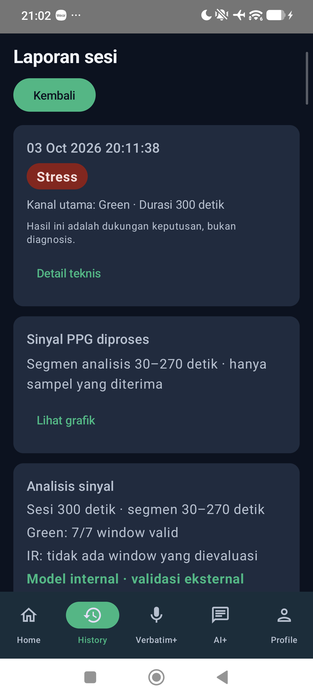

APK `productionDebug` HP yang dipasang in-place pada 3 Oktober 2026 memiliki
SHA-256 `ca71d18d7309c3e71b7f520f82f56d5e1c6e5f1b32b3a598453a3eb908bb3bd1`.
Watch tidak terlihat di ADB saat verifikasi UI ini; screenshot tersebut bukan
bukti penerimaan IR atau validasi klinis.

### Bukti perbaikan grafik dan provenance hasil (4 Oktober 2026)

Frame preview yang terlambat tidak lagi dapat menimpa grafik hasil Home.
Green/IR yang lolos agregasi menampilkan `CLEANED_CORE` dari data yang sudah
diproses untuk inference. Kanal yang ditolak menampilkan raw diagnostik dengan
alasan aktual; Red selalu diagnostik dan memakai snapshot final yang sama.
Detail teknis membedakan probabilitas ONNX mentah dan terkalibrasi, serta
menampilkan ambang, versi model, dan versi kalibrasi. Perbaikan pembulatan
ambang IR menjadi `59%` tidak mengubah keputusan model.

APK phone final dipasang in-place pada `2412DPC0AG`, tanpa uninstall atau clear
data. SHA-256:
`8c28ca7fc207e5233a844ff2f30f9548973defefd87e37007d88eefac5da41c4`.
Watch `SM-R920` terhubung melalui ADB wireless dan aplikasi yang sudah terpasang;
tidak ada perubahan kode Watch pada patch grafik ini.

| Lapisan verifikasi | Evidence aktual | Batas klaim |
| --- | --- | --- |
| Unit production | App 505, inference 31, wear 30, shared 36; 602 test tanpa failure/error/skip | Bukan sesi sensor atau validasi klinis |
| Quality/build | Build APK/test APK, ktlint, detekt dan lint production lulus | Lint masih memiliki 71 warning app (+2 hint) dan 9 warning wear; nol error |
| ONNX pada HP | 100 vektor development riil per kanal; selisih Green `1.6093254089355469e-6`, IR `0.0` | Di bawah `1e-5`; bukan parity preprocessing raw sensor baru |
| Sesi Watch nyata | Home lima menit; Green 7.470 sampel, IR 29.854; 7/7 window Ready dan anotasi MADC pada keduanya | Zero true gap/interpolasi pada window sesi ini, bukan jaminan sesi berikutnya |
| Grafik hasil | Green 6.007 dan IR 24.005 titik cleaned-core; Red raw diagnostik dari snapshot beku | Tidak ada filter kedua atau waveform sintetis untuk tampilan |

Sesi selesai pukul 11:22:17. Pemrosesan tercatat 3.530 ms, termasuk 2.175 ms
evaluasi; tidak ditambahkan waktu tunggu buatan. Probabilitas terkalibrasi median
Green `0.9570058` dan IR `0.8922674` melewati ambang model masing-masing `0.47`
dan `0.59`, sehingga kedua hasil tetap Stress. Nilai ini adalah output model
aktual, **bukan** bukti bahwa labelnya akurat secara klinis. Model tetap memakai
run `20260916T132736Z`, kalibrasi `platt-v2-nested-outer-oof`; tidak ada tuning
threshold atau promosi status release. Tidak ditemukan crash baru pada phone
atau Watch dalam rentang pemeriksaan sesi.

Hasil Home pada perangkat nyata setelah perbaikan:

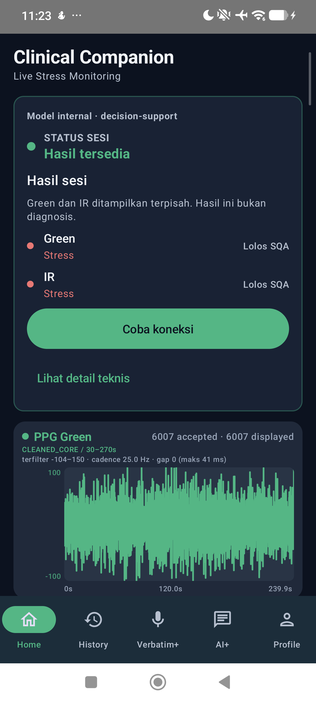

<details>
<summary>Grafik kanal dan detail provenance pada perangkat nyata</summary>

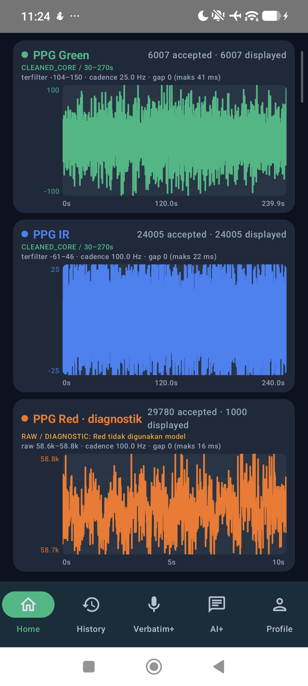

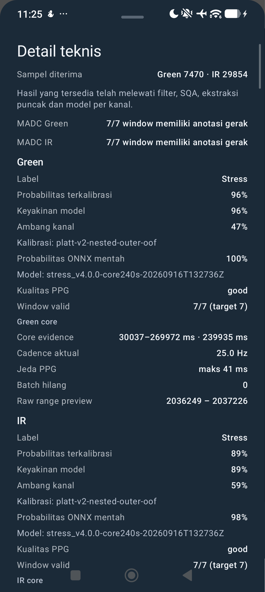

</details>

Pertanyaan mengenai hasil yang sering Stress tetap memerlukan validasi model
dan parity raw-to-feature yang disetujui. Bukti numerik dan batas acceptance
tercatat pada laporan investigasi di proyek ProsesData; tidak ada raw biosignal
baru yang diekspor untuk perbaikan UI ini.

<details>
<summary>SHA-256 APK pada rilis v0.1.0</summary>

- HP: `db8dafbc11fe16bd9e86e72995968bf23c7a7b764b27e0501b1c5c419115fa73`
- Watch: `4c4a57afedb0df13a5e8aa44e112579346ed1d8c3db1d6a06ed67dd1273c021d`

</details>

## Cadangan SAF dan Whisper

Di **Profile → Model offline → Sherpa + Whisper offline**, gunakan **Perbarui → Unduh via Wi-Fi** atau **Impor ZIP lokal**. Bundle hanya diaktifkan setelah checksum dan preflight native berhasil; ZIP/manifest disalin ke `Artifacts/speech-bundle` pada folder SAF yang dipilih. Menginstal APK tidak otomatis memasang bobot Whisper.

Di **Profile → Data dan keamanan**, hubungkan folder SAF lalu pilih **Cadangkan History, AI+, dan Verbatim+**. Pilih kata sandi pemulihan pribadi dan simpan di tempat aman; jangan kirim lewat chat. Tunggu status berhasil dan pastikan tidak ada perubahan tertunda sebelum uninstall. Cadangan terenkripsi berada di `Artifacts/user-data-backup`; pembaruan otomatis berjalan saat aplikasi aktif setelah cadangan pertama berhasil.

Setelah instalasi baru, pilih kembali folder yang sama dan **Pulihkan dari cadangan SAF** dengan kata sandi tersebut, sebelum membuat data lokal baru. Pemulihan menolak database yang sudah terisi atau schema berbeda. Archive mencakup History beserta bukti/grafik, percakapan AI+, transkrip/marker/catatan dan media Verbatim+; dokumen Knowledge Base, konfigurasi reminder dan permission tidak termasuk. Persona/model memiliki slot SAF terpisah. Cadangan penuh dipertahankan dan memakai ruang tambahan.

Kontrak dan batas verifikasi: [SAF recovery contract](../_bmad-output/specs/spec-verbatim-review-cues/saf-recovery-contract.md).

### Preview dan bukti perangkat — 7 Oktober 2026

PNG berikut diambil langsung dari S20 Ultra `RRCN3008VYE`; bukan ilustrasi. Instalasi in-place mempertahankan fingerprint data. Gate software lulus, dan 13 tes non-rekaman pada perangkat lulus; akurasi transkripsi/diarization serta siklus uninstall nyata belum dinyatakan lulus. Rincian source scoped, checksum APK, hasil tes dan batas klaim ada di [acceptance receipt](docs/evidence/saf-recovery-20261007/acceptance.md).

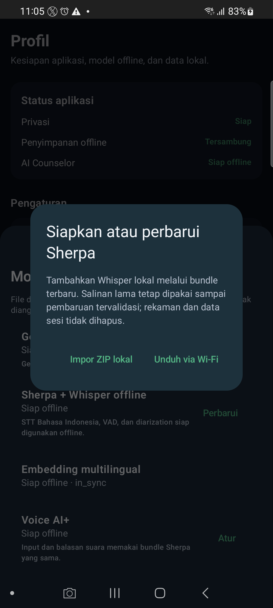

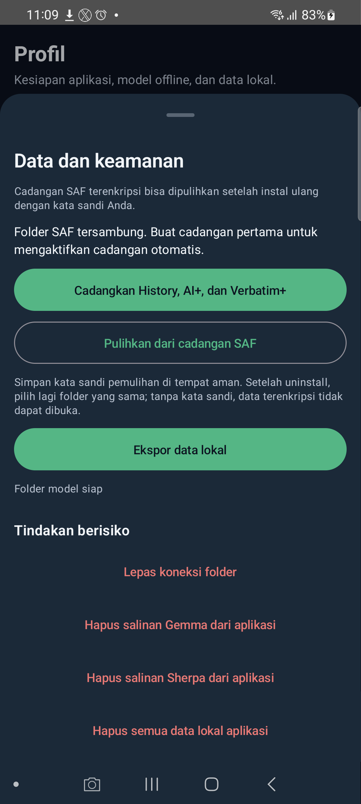

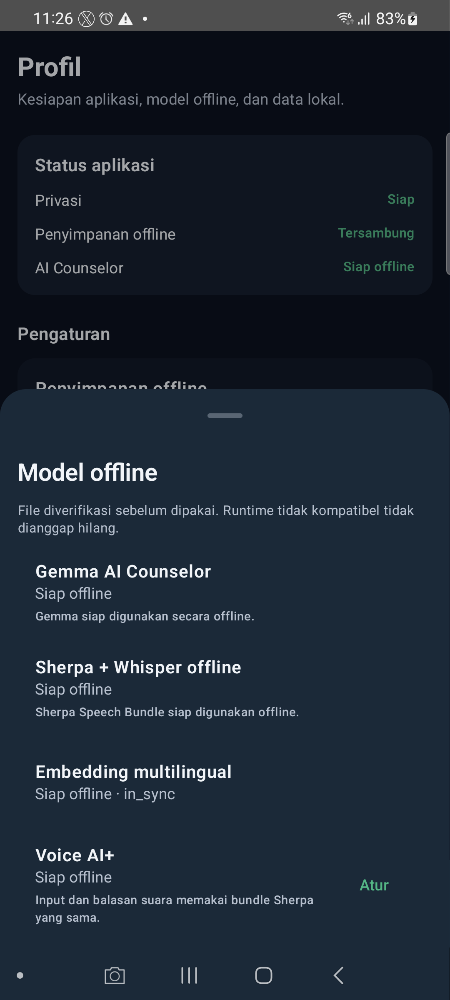

Whisper sudah aktif pada perangkat tersebut, dan checksum ZIP/manifest SAF cocok dengan salinan lokal. Cadangan data pribadi belum diaktifkan: pengguna harus membuat cadangan pertama dengan kata sandinya sendiri sebelum uninstall.
