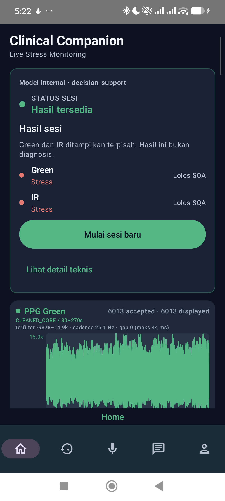
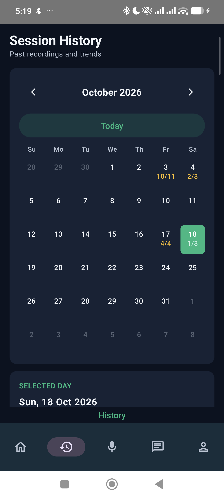
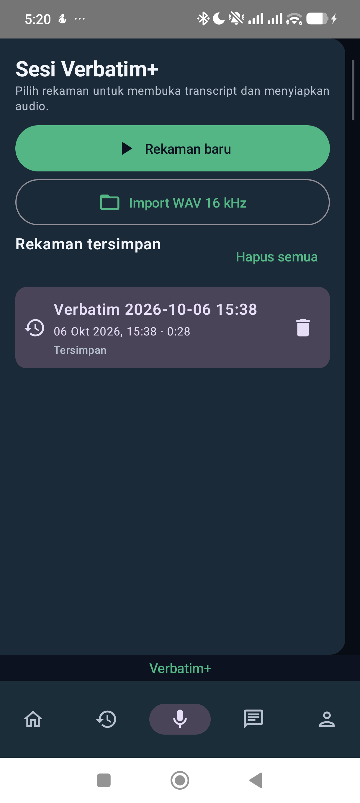
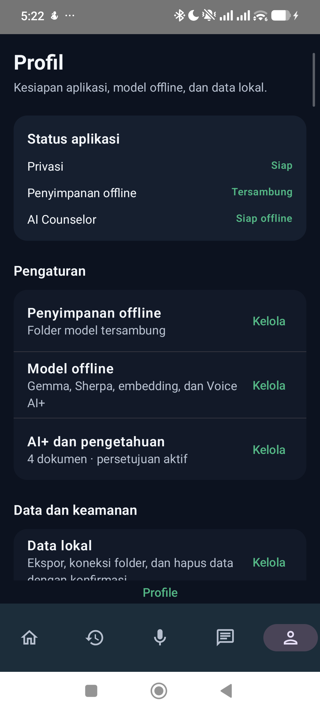
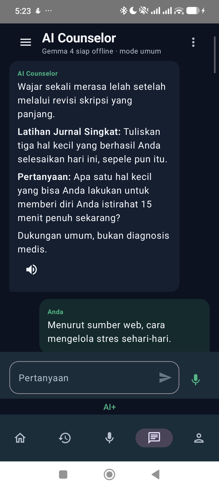
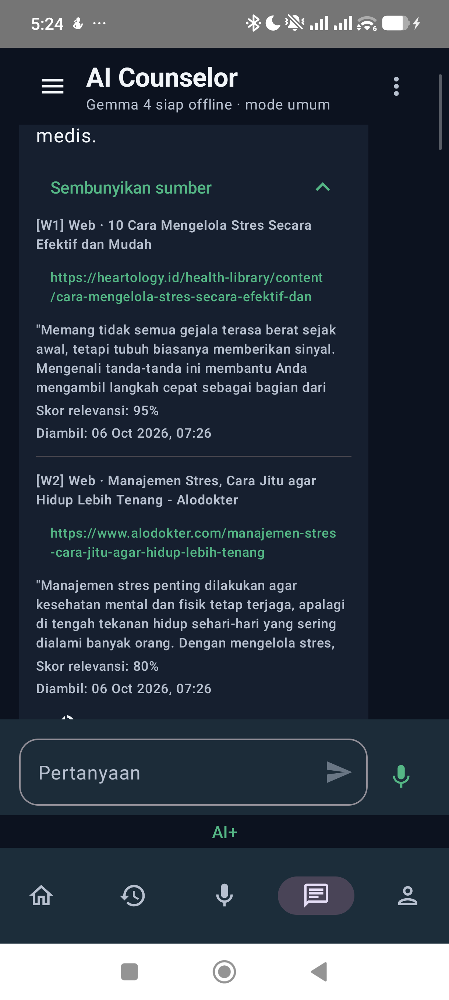

# Stress Detector & Clinical Psychological Companion untuk Android dan Galaxy Watch

Aplikasi pendamping klinis offline yang merekam biosinyal PPG dari Samsung Galaxy Watch (Green, IR, Red) untuk klasifikasi stres real-time menggunakan ONNX Runtime, dilengkapi dengan **Bank Asesmen & Materi Konseling (35+ alat tes psikometri kognitif & kepribadian)**, konseling berbasis **Offline RAG & Persona Adaptation (AI+)**, analisis rekaman audio sesi konseling **Verbatim+**, serta pengamanan menyeluruh **Mobile App Hardening (OWASP MASVS-RESILIENCE)**.

Hasil fisiologis dan psikometri adalah **bantuan pengambilan keputusan (decision-support tool)**, bukan diagnosis medis mutlak atau pendeteksi kebohongan.

---

## 🚀 Release Candidate (RC) — Phone v0.1.6-rc1 (Build Production Release)

- **Unduh Release Candidate**: [`app-production-release.apk`](https://github.com/Adrian463588/android-stress-detection/releases/download/android-v0.1.6-rc1/app-production-release.apk) · [Rincian Rilis v0.1.6-rc1](https://github.com/Adrian463588/android-stress-detection/releases/tag/android-v0.1.6-rc1)
- **Target Arsitektur (ABI)**: `arm64-v8a` (dioptimasi penuh), `armeabi-v7a`, `x86_64`
- **Konfigurasi Android**: Package `com.stressdetector`, Min SDK 26 (Android 8.0 Oreo), Target SDK 34 (Android 14 UpsideDownCake), Compile SDK 35 (Android 15 VanillaIceCream), Version Code `7`, Version Name `0.1.6-rc1`.
- **Ukuran File**: `286,793,076 byte` (~273.5 MB, memuat offline speech model Sherpa-ONNX, openSMILE config, model ONNX biosinyal, dan katalog offline psikometri).
- **Integritas & Checksum SHA-256**:
  ```text
  A0B291F55B150824F430BCE26B6FA61F873A8F412731C08FA0F2D5156246539E  app-production-release.apk
  ```
- **Status Verifikasi Perangkat Nyata**: Teruji dan berjalan mulus pada Samsung Galaxy S20 Ultra (`SM-G988B`, serial `RRCN3008VYE`) dan Xiaomi 14 (`2412DPC0AG`). Seluruh modul (Home, History, Verbatim+, AI Counselor, Bank Asesmen, dan Profile) berfungsi 100% offline tanpa ketergantungan server luar.

---

## 🛡️ Mobile App Hardening & Security (OWASP MASVS-RESILIENCE)

Aplikasi beroperasi secara **100% offline** tanpa transmisi ke cloud atau server backend. Untuk melindungi hak kekayaan intelektual algoritma, mencegah tampering (modifikasi APK), dan menjaga kerahasiaan data klinis pasien, diterapkan arsitektur keamanan berlapis (*Defense-in-Depth*):

```text
+-----------------------------------------------------------------------------------+
|                        MOBILE APP HARDENING ARCHITECTURE                          |
+-----------------------------------------------------------------------------------+
| [Layer 1: ProGuard / R8 Full Mode]                                                |
|  - Aggressive dead code stripping & resource shrinking                           |
|  - Repackage classes ('') to obscure package hierarchy                            |
|  - 5-pass bytecode optimization & logging scrubber (android.util.Log removed)   |
|  - Native symbols stripped (debugSymbolLevel = "none")                            |
+-----------------------------------------------------------------------------------+
| [Layer 2: Native C/C++ Security (NDK / libsecure_file_ops.so)]                    |
|  - In-memory ptrace anti-debugging test (PTRACE_TRACEME self-attach)              |
|  - /proc/self/status TracerPid scanning                                           |
|  - /proc/self/maps memory inspection (Frida, Xposed, Substrate hooks)              |
|  - /proc/net/tcp port scanning (Frida default server port 27042)                  |
+-----------------------------------------------------------------------------------+
| [Layer 3: APK Integrity & Anti-Tampering]                                         |
|  - Genuine package name verification (com.stressdetector)                         |
|  - Genuine signing certificate SHA-256 fingerprint verification                   |
|  - API 33+ (Tiramisu) PackageInfoFlags compatibility without NewApi lint error    |
|  - Java Debugger active detection (Debug.isDebuggerConnected, FLAG_DEBUGGABLE)    |
|  - Root environment scan (su binary paths, Magisk dirs, test-keys build tags)     |
+-----------------------------------------------------------------------------------+
| [Layer 4: Hardware-Backed Keystore & Storage Encryption]                          |
|  - Android Keystore System (AndroidKeyStore) AES-256-GCM authenticated encryption |
|  - MasterKey provider for local clinical session data & private keys               |
|  - SecureStorageManager for clinical exports & assessment history                 |
+-----------------------------------------------------------------------------------+
| [Layer 5: Offline Asset & Manifest Integrity]                                     |
|  - SHA-256 digest validation of psychometrics catalog.json & protocols.json      |
|  - Bundled RAG knowledge manifest checksum enforcement                            |
+-----------------------------------------------------------------------------------+
```

---

## 🧠 Bank Asesmen & Materi Konseling (35+ Alat Tes Psikometri)

Aplikasi menyediakan bank asesmen psikologi terlengkap yang dapat dikerjakan langsung secara digital di perangkat Android (dengan input sentuhan jari maupun stylus Samsung S Pen) maupun dihitung melalui kalkulator rekapitulasi skor:

### 1. Asesmen Kognitif & Inteligensi (Pengerjaan Langsung & Skoring Otomatis)
- **Wonderlic Personnel Test (WPT)**: 50 butir soal kognitif penalaran logika, numerik, dan verbal otentik dengan batas waktu ketat 12 menit. Dilengkapi konversi skor mentah ke norma inteligensi umum dan interpretasi kapasitas belajar kerja.
- **TIU 5 (Tes Inteligensi Umum 5)**: 30 butir soal penalaran figural (analogi dan serial bentuk gambar geometris) dengan stimulus gambar tajam, skoring otomatis, dan konversi ke norma standar kognitif.
- **TIU 6 (Tes Inteligensi Umum 6 - Spatial Net / Jaring-Jaring 3D)**: 40 butir stimulus jaring-jaring bangun ruang (9 ragam bentuk: balok, kubus, prisma, piramida, kerucut terpancung) dalam 8 baris soal. Opsi toggle respons interaktif ("Dapat Dilipat Utuh" / "Tidak Dapat Dilipat").
- **Raven's Standard Progressive Matrices (SPM)**: 60 butir soal penalaran non-verbal (Set A, B, C, D, E) lengkap dengan stimulus matriks pola dan potongan gambar pilihan jawaban. Menghasilkan skor mentah, persentil, dan grade inteligensi (Grade I s.d. Grade V).
- **Culture Fair Intelligence Test (CFIT 3A & CFIT 2A)**: 50 butir (Skala 3A) dan 46 butir (Skala 2A) bebas budaya yang terbagi ke dalam 4 subtes: Seri Gambar, Klasifikasi Bentuk, Matriks Pola, dan Kondisi Topologis Persyaratan Titik. Pemotongan gambar presisi tinggi dengan konversi IQ standar Cattell.
- **Army Alpha Intelligence Test (Form A / UI-10013-96)**: 12 subtes pengukuran ketangkasan mental dan eksekusi instruksi lisan/visual (instruksi lingkaran/angka, aritmatika, praktis, sinonim-antonim, deret angka, analogi verbal, hingga peribahasa). Dilengkapi interpretasi IQ dan grade mental.
- **Intelligenz Struktur Test (IST)**: 9 subtes terintegrasi (SE, WA, AN, GE, ME, RA, ZR, FA, WU) dengan psikogram komprehensif.

### 2. Asesmen Kepribadian, Sikap Kerja, & Minat
- **PAPI Kostick (20 Dimensi Kerja)**: 90 pasang pernyataan preferensi kerja (kebutuhan kerja dan peran kepemimpinan). Menghasilkan psikogram diagram jaring laba-laba (*spider web chart*).
- **Edward Personal Preference Schedule (EPPS)**: 225 pasang pilihan paksa (*forced-choice*) mengukur 15 kebutuhan psikologis Murray dan skor konsistensi kejujuran (Consistency Score).
- **Management Style Diagnosis Test (MSDT)**: 64 butir gaya kepemimpinan Reddin (Dedicated, Integrated, Related, Separated, Developer, Benevolent Autocrat, Bureaucrat, Compromiser, Missionary, Autocrat, Deserter, Executive).
- **Management Skills Assessment Instrument (MSAI)**: 12 kompetensi manajerial Quin.
- **Enneagram**: 9 tipe kepribadian adaptif dengan identifikasi *wing* dan level integrasi/disintegrasi.
- **Self-Reporting Questionnaire (SRQ-29)**: Skrining 29 gejala gangguan mental emosional, neurotik, psikotik, dan penyalahgunaan zat.
- **Visual-Auditory-Kinesthetic (VAK)**: Modalitas gaya belajar dominan.
- **Tes Pauli & Kraepelin**: Tes ketahanan kerja, kecepatan, ketelitian, dan stabilitas emosi melalui kalkulasi penjumlahan angka acak.
- **16PF, MBTI, DISC, RMIB (Rothwell-Miller Interest Blank)**.

### 3. Asesmen Proyektif Klinis
- **Tes Rorschach (Inkblot Test)**: 10 kartu bercak tinta otentik (Kartu I s.d. X) dengan alur fase respon (*Response Phase*) dan fase penelusuran (*Inquiry Phase*). Dilengkapi protokol *Exner Comprehensive System (CS)* untuk koding Lokasi (W, D, Dd, S), Perkembangan Bentuk (DQ), Determinan (F, M, FM, m, C, CF, FC, T, Y, V), Kualitas Bentuk (FQ), Konten (H, (H), A, (A), Art, Id), dan Popular (P), serta indeks EB, EA, es, D-Score, CDI, S-CON, dan DEPI.
- **Tes Wartegg (8 Kotak Stimulus)**: Analisis gambar arketipal 8 figur dengan urutan penarikan garis, profil kepribadian, dan dinamika emosi.

---

## 🤖 Integrasi AI Counselor (AI+) & Offline RAG

Seluruh hasil asesmen yang telah diselesaikan disimpan secara aman di database lokal Room (`clinical_assessments`). Ketika konselor atau pengguna berinteraksi di tab **AI+ (AI Counselor)**:
1. **Context-Aware Retrieval**: Sistem RAG lokal secara otomatis mengambil skor, ringkasan subskala, dan interpretasi psikotes pasien yang relevan via pencarian hybrid BM25 + cosine similarity embedding lokal.
2. **Adaptive Persona Synthesis**: Prompt sistem konselor memadukan data fisiologis stres (rata-rata detak jantung, RMSSD, level stres) dan profil psikometri untuk menyusun respons empati, psikoedukasi terarah, dan rekomendasi intervensi psikologis yang dipersonalisasi.
3. **Privasi 100% Terjaga**: Seluruh proses embedding, penalaran LLM offline, dan penyimpanan data tidak pernah meninggalkan memori lokal perangkat.

---

## 🏷️ GitHub Topics & Metadata Repository

Untuk meningkatkan *discoverability* di GitHub, disarankan menambahkan topik berikut pada pengaturan repositori:
```text
android, jetpack-compose, biosignals, ppg, ecg, hrv, stress-detection, wearos, psychometrics, psychological-assessment, counseling, offline-ai, rag, owasp-masvs, app-hardening, mobile-security, onnx-runtime, sherpa-onnx, material-3
```

---

## Versi sebelumnya — Phone v0.1.5 / Watch v0.1.1 tetap

- [Unduh Phone v0.1.5](https://github.com/HRVSkripsi/CleaningDataAdrian/releases/download/android-v0.1.5/app-production-debug.apk) · [rincian rilis](https://github.com/HRVSkripsi/CleaningDataAdrian/releases/tag/android-v0.1.5) · [SHA-256](docs/evidence/stress-parity-20261017/SHA256SUMS-0.1.5.txt). Repository private; akun perlu diberi akses.
- APK debug internal, package `com.stressdetector`, version code 6. Perbaikan menyamakan laju filter/fitur dengan artifact model dan melengkapi fingerprint preprocessing sesi; model run `20260916T132736Z`, kalibrasi dan threshold tidak diganti.
- Terpasang in-place pada Xiaomi `2412DPC0AG` dengan `-r -d`. Identitas direktori data, waktu instalasi pertama dan tiga laporan lama yang diperiksa tetap utuh. Capture raw debug sudah dikembalikan ke nonaktif.
- Replay rekaman Watch aktual melalui APK baru cocok dengan Python pada cleaning, fitur dan ONNX, 7/7 window Green serta 7/7 IR. Ini bukti replay numerik, bukan rekaman sensor baru.
- Sesi fisik baru 300 detik: Green **Normal**, 7/7 window valid; IR **Sinyal tidak cukup** akibat gap. Grafik `CLEANED_CORE` tersimpan dan dapat dibuka di History. Verifikasi capture penuh tetap **NO_GO** karena tiga konflik timestamp batas batch Red diagnostik; pemeriksaan numerik Green saja lulus dan tidak dijadikan receipt sensor penuh.
- JVM 903/903, ktlint, detekt, lint production Phone/Wear dan assembly lulus. Suite Python aktif terakhir: 468 lulus, tanpa skip, satu warning; Ruff lulus. Tidak ada crash baru package target pada interval pengujian.
- [Bukti, perbandingan Agustus dan pekerjaan yang masih terbuka](docs/evidence/stress-parity-20261017/acceptance.md). Akurasi/false positive belum terselesaikan oleh parity software; ini bukan alat diagnosis. AI+, Verbatim+, seluruh ukuran layar dan TalkBack tidak diuji ulang pada perubahan ini.
- [Watch v0.1.1](https://github.com/Adrian463588/android-stress-detection/releases/download/android-v0.1.1/wear-production-debug.apk) tetap companion; tidak ada APK Watch baru pada rilis ini.

Preview Home sesudah replacement, sebelum probe sesi berhasil. Respons Watch pada gambar telah kedaluwarsa; state diblokir ini bukan bukti perekaman gagal:


## Preview sebelumnya — Phone v0.1.4 / Watch v0.1.1

- [Unduh Phone v0.1.4](https://github.com/HRVSkripsi/CleaningDataAdrian/releases/download/android-v0.1.4/app-production-debug.apk) · [rincian rilis](https://github.com/HRVSkripsi/CleaningDataAdrian/releases/tag/android-v0.1.4).
- [Unduh Watch v0.1.1](https://github.com/Adrian463588/android-stress-detection/releases/download/android-v0.1.1/wear-production-debug.apk) · [rincian rilis](https://github.com/Adrian463588/android-stress-detection/releases/tag/android-v0.1.1).
- [SHA-256](docs/evidence/permission-onboarding-20261017/SHA256SUMS-0.1.4.txt) · [evidence dan batas acceptance](docs/evidence/permission-onboarding-20261017/acceptance.md).
- [Receipt instalasi Phone+Watch, baseline rollback, dan verifikasi pelestarian data](docs/evidence/paired-update-20261017/acceptance.md).
- APK debug internal, package `com.stressdetector`, version code 5. Unduh memerlukan akses ke repository private.
- Watch v0.1.1 memakai package yang sama dan launch smoke lulus pada Galaxy Watch SM-R920. Data Layer, streaming PPG, dan sesi stres tidak diuji dalam acceptance instalasi ini.
- Tombol Home `Izinkan aplikasi` membuka satu sheet yang memuat Lokasi, Mikrofon, Bluetooth, Perangkat sekitar, Notifikasi, dan Penyimpanan. `Izinkan akses yang diperlukan` meminta semua runtime permission yang masih kurang dan berlaku pada versi Android itu. Sistem Android menentukan urutan/pengelompokan dialog; SAF membuka pemilih dokumen tanpa akses storage luas.
- Uji manual di Android 13 menampilkan dialog native Mikrofon dan Notifikasi. Nearby devices adalah grup izin Bluetooth; izin scan sudah aktif sehingga Android tidak menampilkan dialog kedua. Lokasi ditandai tidak diperlukan pada API ini.
- APK dipasang dengan `adb install --user 0 -r -d`; `firstInstallTime` dan inode data tetap sama. Izin sementara dari uji dikembalikan; Home diluncurkan ulang dan menampilkan Watch tidak tersedia karena Watch tidak terhubung.
- Unit test JVM 885/885, ktlint, detekt, lint phone/Wear dan assembly lulus. Ini tidak membuktikan koneksi Watch, PPG, perekaman mikrofon, atau delivery notifikasi.


[Unduh Phone v0.1.5](https://github.com/Adrian463588/android-stress-detection/releases/download/android-v0.1.5/app-production-debug.apk) · [Unduh Watch v0.1.1](https://github.com/Adrian463588/android-stress-detection/releases/download/android-v0.1.5/wear-production-debug.apk) · [Semua rilis](https://github.com/Adrian463588/android-stress-detection/releases)

> **Status distribusi:** Phone v0.1.5 adalah prerelease debug untuk evaluasi internal, bukan rilis Play Store. Repository privat; unduhan memerlukan akun GitHub dengan akses. Watch v0.1.1 adalah companion terbaru dan tidak berubah pada rilis Phone v0.1.5.

## Keamanan dan kesiapan publikasi

Repository tetap privat sampai pemilik mengubah visibilitasnya. Audit 18 Oktober 2026 tidak menemukan credential pada reachable Git history atau field nama partisipan eksplisit. Satu AAR Sherpa-ONNX v1.13.4 berukuran 37,6 MB masih ada di history pada path `app/libs/sherpa-onnx-static-link-onnxruntime-1.13.4.aar` dengan SHA-256 `dc5ac19a28dee3bffc5e5a5d50cb6afa977703fc4a7ee535a308506990fdd295`; pemilik mengonfirmasi artefak Sherpa historis boleh dipertahankan. AAR Samsung Health Sensor SDK tidak ditemukan pada refs atau aset rilis yang diaudit. Scanner hanya mengecualikan blob Sherpa tersebut berdasarkan path dan checksum persis; AAR apa pun di working tree atau AAR lain di history tetap ditolak. Tidak diperlukan rewrite history atau force-push.

- Phone dan Watch memakai R8 minification serta resource shrinking hanya pada `release`; build `debug` dan APK prerelease yang tertaut di atas tetap debug preview.
- Build mengambil Sherpa-ONNX v1.13.4 dari rilis upstream HTTPS ke `app/build/third-party/`, lalu memeriksa ukuran dan SHA-256 tetap sebelum dipakai. `*.aar` diabaikan Git; Samsung Health Sensor SDK tetap perlu disediakan lokal untuk build Watch.
- Workflow `Publication safety` menjalankan pemeriksaan artifact/field identitas pada working tree dan seluruh reachable history, serta Gitleaks full-history. Temuan tidak mencetak nilai atau path sensitif ke log.
- R8 adalah defense-in-depth, bukan jaminan anti-reverse-engineering. Source publik memang dapat dibaca; signing key tidak disimpan di repository. Release yang dibuat tanpa signing key owner tetap unsigned dan tidak boleh dipromosikan sebagai rilis produksi.
- GitHub Secret Scanning saat audit masih nonaktif pada repository privat ini. Setelah repository menjadi public, verifikasi Secret Scanning dan Push Protection di GitHub Settings; workflow tetap menjadi pemeriksaan independen.
- [Unduh Phone v0.1.4 historis](https://github.com/HRVSkripsi/CleaningDataAdrian/releases/download/android-v0.1.4/app-production-debug.apk) · [rincian v0.1.4](https://github.com/HRVSkripsi/CleaningDataAdrian/releases/tag/android-v0.1.4) — izin aplikasi dan update paired; tidak berisi perbaikan cadence v0.1.5.
- [Unduh Phone v0.1.3 historis](https://github.com/HRVSkripsi/CleaningDataAdrian/releases/download/android-v0.1.3/app-production-debug.apk) · [rincian v0.1.3](https://github.com/HRVSkripsi/CleaningDataAdrian/releases/tag/android-v0.1.3) — alur izin lama, hanya Watch.
- [Unduh Phone v0.1.2 preview](https://github.com/Adrian463588/android-stress-detection/releases/download/android-v0.1.2/app-production-debug.apk).
- [Rilis v0.1.2 dan keterbatasannya](https://github.com/Adrian463588/android-stress-detection/releases/tag/android-v0.1.2), [checksum SHA-256](https://github.com/Adrian463588/android-stress-detection/releases/download/android-v0.1.2/SHA256SUMS-0.1.2.txt).
- [Unduh companion Watch v0.1.1](https://github.com/Adrian463588/android-stress-detection/releases/download/android-v0.1.1/wear-production-debug.apk) — tidak berubah pada rilis ini.
- [Unduh Phone v0.1.1 preview](https://github.com/Adrian463588/android-stress-detection/releases/download/android-v0.1.1/app-production-debug.apk).
- [Rilis v0.1.1 dan keterbatasannya](https://github.com/Adrian463588/android-stress-detection/releases/tag/android-v0.1.1), [checksum SHA-256](https://github.com/Adrian463588/android-stress-detection/releases/download/android-v0.1.1/SHA256SUMS.txt).
- [Rilis historis Android](https://github.com/Adrian463588/android-stress-detection/releases).
- [Phone dan Watch v0.1.0](https://github.com/Adrian463588/android-stress-detection/releases/tag/android-v0.1.0).

Sebelum mengubah visibilitas repository, jalankan `python scripts/check_publication_safety.py --history`, Gitleaks full-history scan, dan inventaris aset rilis. Pemeriksaan history menerima hanya artefak Sherpa lama yang dijelaskan di atas; jangan menambahkan pengecualian lain atau mengabaikan temuan baru.

## Ringkasan proyek

Phone menjadi pusat UI, pemrosesan, hasil, riwayat, AI+, dan Verbatim+. Watch menyediakan pengukuran PPG aktual. Model stres di Android memakai satu kanal PPG per model; ECG hanya digunakan sebagai referensi validasi pada pipeline penelitian, bukan input model aplikasi.

Model yang dikemas dikunci ke run **20260916T132736Z**. Green dan IR dievaluasi terpisah; Red hanya diagnostik. Jika data atau kualitas sinyal tidak cukup, aplikasi harus abstain alih-alih mengarang nilai atau hasil.

## Unduhan terbaru

| Aplikasi | Versi | Package | SHA-256 | Unduhan |
| --- | --- | --- | --- | --- |
| Phone | 0.1.5 · versionCode 6 | com.stressdetector | 073531f002e8f9a41fd600a0629b43916331c0bac0ccb68cff7abafae9f838d3 | [APK](https://github.com/Adrian463588/android-stress-detection/releases/download/android-v0.1.5/app-production-debug.apk) |
| Watch | 0.1.1 · versionCode 2 | com.stressdetector | 3ea5fd86c13105244350eab8ea7713cc793df0fbde8d1ba626f3b09a8bc8cf96 | [APK](https://github.com/Adrian463588/android-stress-detection/releases/download/android-v0.1.5/wear-production-debug.apk) |

- [Catatan rilis v0.1.5](docs/releases/android-v0.1.5.md)
- [File checksum rilis](https://github.com/Adrian463588/android-stress-detection/releases/download/android-v0.1.5/SHA256SUMS-0.1.5.txt)
- [Halaman rilis v0.1.5](https://github.com/Adrian463588/android-stress-detection/releases/tag/android-v0.1.5)

Angka checksum di atas dibandingkan dengan digest aset GitHub pada 18 Oktober 2026. Repository privat berarti pengunduh tanpa akses tidak dapat mengambil APK.

### Riwayat versi

| Tag | Phone | Watch | Status |
| --- | --- | --- | --- |
| [android-v0.1.5](https://github.com/Adrian463588/android-stress-detection/releases/tag/android-v0.1.5) | 0.1.5 | 0.1.1 | Prerelease terbaru; internal debug |
| [android-v0.1.2](https://github.com/Adrian463588/android-stress-detection/releases/tag/android-v0.1.2) | 0.1.2 | 0.1.1 | Historis |
| [android-v0.1.1](https://github.com/Adrian463588/android-stress-detection/releases/tag/android-v0.1.1) | 0.1.1 | 0.1.0 | Historis |
| [android-v0.1.0](https://github.com/Adrian463588/android-stress-detection/releases/tag/android-v0.1.0) | 0.1.0 | 0.1.0 | Rilis non-prerelease yang ditandai GitHub sebagai “Latest” |

GitHub masih menandai v0.1.0 sebagai rilis non-prerelease terbaru karena v0.1.5 ditandai prerelease. v0.1.5 tetap APK aplikasi terbaru yang tersedia di repo.

### Instalasi/update

Unduh APK Phone dan Watch dari pasangan di atas. Update APK Phone pada perangkat yang sama tanpa menghapus data:

    adb -s <serial-phone> install -r -d app-production-debug.apk

Gunakan serial yang benar-benar tampil pada `adb devices -l`:

```powershell
$phoneSerial = Read-Host 'Serial ADB Phone'
$watchSerial = Read-Host 'Serial ADB Watch'
adb -s $phoneSerial install -r -d .\app-production-debug.apk
adb -s $watchSerial install -r -d .\wear-production-debug.apk
```

Opsi tersebut memasang ulang secara in-place. Jangan menjalankan uninstall atau pm clear sebagai langkah update. Kedua perangkat harus memakai package dan signing identity yang kompatibel agar Wear Data Layer dapat berkomunikasi.

## Fitur aplikasi

| Menu | Fungsi | Batas bukti terbaru |
| --- | --- | --- |
| **Home** | Memeriksa kesiapan model, izin, dan reachability Watch; merekam sesi stress 5 menit; menampilkan hasil dan kualitas Green/IR. | Paket v0.1.5 lolos 868 JVM tests dan gate build/lint yang tercatat. Replay lulus untuk 7 window Green dan 7 IR. Pada satu sesi baru, Green menghasilkan Normal dan IR abstain karena gap. Full-channel acceptance masih NO_GO karena konflik timestamp diagnostik Red. |
| **History** | Meninjau sesi tersimpan, hasil, kualitas, grafik, serta detail provenance. | Screenshot kalender diambil dari Xiaomi v0.1.5 pada 18 Oktober 2026. Ini bukti tampilan dan navigasi, bukan verifikasi seluruh operasi history. |
| **Verbatim+** | Merekam dan meninjau audio/transkrip/marker; PPG Watch dapat menjadi konteks sesi bila tersedia. Audio tetap harus menunjukkan statusnya sendiri ketika Watch tidak tersedia. | Screenshot daftar sesi diambil dari Xiaomi v0.1.5 pada 18 Oktober 2026. Perekaman audio, STT, dan sinkronisasi Watch tidak diuji dalam smoke test dokumentasi ini. |
| **AI+** | Counselor lokal Gemma, retrieval dokumen, sitasi, dan pencarian web setelah persetujuan/opt-in yang sesuai. | Screenshot v0.1.5 menampilkan percakapan counselor dan panel sumber W1/W2 dalam satu kontrol. Ini membuktikan rendering state yang tersimpan, bukan validitas URL, keberhasilan fetch baru, atau faithfulness jawaban. Corpus bawaan belum tervalidasi. |
| **Profile** | Mengelola izin, model/bundle offline, storage, backup, serta pengaturan terkait. | Screenshot overview diambil dari Xiaomi v0.1.5 pada 18 Oktober 2026. Status yang terlihat bukan verifikasi semua operasi Profile. |

Semua hasil tetap bersifat non-diagnostik. Hasil Stress atau Normal adalah keluaran model pada data sesi tertentu, bukan pengukuran langsung atas perasaan pengguna atau validasi klinis. Green/IR tidak digabung atau dirata-ratakan. Akselerometer dapat digunakan untuk anotasi MADC per window jika sampel Watch aktual tersedia; data gerak bukan fitur model dan tidak memperbaiki waveform.

## Alur pengguna

~~~mermaid
flowchart TD
    A[Home] --> B{Izin, model, dan Watch siap?}
    B -- Tidak --> C[Perbaiki prasyarat / coba koneksi]
    C --> B
    B -- Ya --> D[Rekam PPG aktual selama 5 menit]
    D --> E[Validasi transport, SQA, dan preprocessing]
    E --> F{Window valid tersedia?}
    F -- Tidak --> G[INSUFFICIENT_SIGNAL]
    F -- Ya --> H[Inferensi ONNX Green dan IR secara terpisah]
    H --> I[Hasil aktual dan kualitas]
    G --> J[Simpan / tinjau di History]
    I --> J
    A --> K[Verbatim+ audio dan transkrip]
    A --> L[AI+ lokal / dokumen / web berizin]
    A --> M[Profile, model, izin, dan data]
~~~

## Stack dan arsitektur

- **Bahasa dan UI:** Kotlin, Jetpack Compose, Material 3.
- **Pola aplikasi:** MVVM, ViewModel, coroutines/Flow, unidirectional data flow.
- **Penyimpanan lokal:** Room dan penyimpanan terlindungi sesuai kontrak fitur.
- **Wear:** Wear OS, Google Play Services Wear Data Layer, Samsung Health Sensor SDK.
- **Biosignal:** preprocessing dan SQA/MADC; ONNX Runtime untuk inferensi lokal.
- **AI+:** Gemma lokal/LiteRT-LM, retrieval dokumen lokal, serta gateway web yang terikat consent.
- **Audio:** pemrosesan native untuk fitur akustik dan pipeline speech sesuai artifact/runtime yang tersedia.
- **Build:** Gradle, Android Gradle Plugin, JDK 17.

Batas utama: model stres Android menggunakan PPG. ECG, identitas, metadata sesi, dan kanal saudara tidak menjadi predictor. Data sintetis, fake status, citation buatan, dan prediksi saat sinyal tidak memadai dilarang.

## Struktur repository

    .
    ├── app/          # Aplikasi Phone, Compose UI, ViewModel, penyimpanan dan koordinasi
    ├── wear/         # Aplikasi Watch, sensor dan pengiriman batch PPG
    ├── shared/       # Kontrak pesan dan model data Phone–Watch
    ├── inference/    # Kontrak model, preprocessing dan ONNX runtime
    ├── config/       # Konfigurasi build/pipeline yang digunakan repo ini
    ├── docs/         # Panduan perangkat, release notes, screenshot dan evidence
    ├── gradle/       # Gradle wrapper dan konfigurasi
    ├── build.gradle
    └── settings.gradle

## Galeri UI perangkat

Screenshot berikut diambil langsung dari Xiaomi POCO X7 Pro (`2412DPC0AG`, serial ADB `QSWSEMRKNFZ9LJRC`) pada 18 Oktober 2026. Package `com.stressdetector` yang terpasang adalah Phone v0.1.5, versionCode 6. Ini smoke test navigasi dan rendering pada lima tab; tidak mengubah data aplikasi dan tidak membuktikan seluruh alur fitur, akurasi model, atau penerimaan end-to-end Watch. [Rincian capture dan checksum PNG](docs/evidence/readme-screenshots-xiaomi-20261018.md).

| Home | History |
| --- | --- |
|  |  |

| Verbatim+ | Profile |
| --- | --- |
|  |  |

| AI+ — percakapan | AI+ — satu panel sumber |
| --- | --- |
|  |  |

Catatan pembacaan screenshot:

- Home memperlihatkan hasil tersimpan `Stress` untuk Green dan IR. Ini adalah state lokal yang tampil pada perangkat, bukan bukti bahwa hasil tersebut sesuai kondisi subjektif, benar secara klinis, atau terbebas dari masalah provenance. Lihat [catatan rilis dan batas penerimaan](docs/releases/android-v0.1.5.md) sebelum menafsirkan hasil.
- AI+ menampilkan percakapan tersimpan. Panel sumber memperlihatkan W1/W2, URL, cuplikan, dan skor relevansi yang ditampilkan aplikasi; screenshot bukan verifikasi independen atas kualitas web fetch, sitasi, atau jawaban.
- History, Verbatim+, dan Profile hanya dinavigasi untuk mengambil tampilan. Tidak ada sesi rekaman, penghapusan, ekspor, atau perubahan model dijalankan.

Screenshot historis dari build/perangkat lain tetap tersedia pada [galeri arsip](docs/evidence/README-screenshots-archive.md); screenshot tersebut tidak digunakan sebagai bukti tampilan v0.1.5.

## Status verifikasi dan batas penerimaan

| Area | Bukti yang tersedia | Status |
| --- | --- | --- |
| Unit test Phone/Inference/Shared | 796 + 34 + 38 = 868 JVM tests, tanpa failure/error/skip pada verification receipt v0.1.5. | Lulus pada scope tersebut |
| Static checks dan APK Phone | ktlintCheck, detekt, app/inference production lint, dan assembleProductionDebug dilaporkan lulus. | Lulus pada scope tersebut |
| Watch module pada checkout v0.1.5 | Samsung Health Sensor SDK AAR tidak tersedia; Watch test/compile tidak diklaim lulus di checkout itu. | Belum diverifikasi |
| UI Xiaomi | Pada 18 Oktober, ADB melihat model 2412DPC0AG, Android 16, screen 1220×2712, dan package com.stressdetector v0.1.5/versionCode 6. Lima tab dibuka dan screenshot PNG aktual disimpan; tidak ada tindakan yang mengubah data. | UI/navigation smoke lulus; bukan E2E |
| PPG dan prediksi | Replay satu rekaman lulus 7 window Green + 7 IR. Satu sesi langsung: Green Normal, IR insufficient signal. Red timestamp conflict membuat full-channel acceptance NO_GO. | Partial; bukan validasi klinis |
| AI+ | Layar v0.1.5 menampilkan percakapan Web tersimpan dan daftar W1/W2. Tidak dilakukan pencarian baru atau audit faithfulness pada smoke ini; corpus lokal belum lulus benchmark. | UI display terverifikasi; grounded-web acceptance masih partial |
| Verbatim+ | Daftar sesi dan navigasi UI terlihat pada Xiaomi v0.1.5; tidak ada rekaman/import/delete yang dijalankan. | Audio/STT/Watch end-to-end terbaru belum diklaim |
| Profile dan backup | Overview Profile dibuka pada Xiaomi v0.1.5; aksi operasi data/model tidak dijalankan. | Semua operasi belum diverifikasi pada v0.1.5 |

**Kesimpulan:** repo ini belum memiliki bukti yang mendukung klaim “semua fitur telah lolos end-to-end pada v0.1.5”. Status yang belum lulus atau belum diuji ditampilkan terbuka agar README tidak menjadi klaim pemasaran yang menyesatkan.

- [Catatan rilis v0.1.5](docs/releases/android-v0.1.5.md)
- [Panduan uji perangkat](docs/device-test-guide.md)
- [Evidence capture Xiaomi terbaru](docs/evidence/readme-screenshots-xiaomi-20261018.md)
- [Evidence AI+ historis](docs/evidence/ai-plus-20261005/acceptance.md)
- [Evidence Verbatim+](docs/verbatim-device-acceptance-20261006.md)

## Build dan pengujian

Persyaratan: JDK 17, Android SDK, Gradle wrapper repository, model index dan detector contract dari run 20260916T132736Z, serta Samsung Health Sensor SDK 1.4.1 lokal untuk modul Watch. Gradle mengambil AAR Sherpa yang dipin dari rilis resmi dan menolak ukuran/checksum yang berbeda; artifact tersebut berada hanya di ignored build output. AAR Samsung juga tetap lokal dan tidak disimpan di Git. Distribusi aplikasi yang memakai SDK Samsung memerlukan persetujuan partner Samsung; baca [ketentuan resmi Developer Mode](https://developer.samsung.com/health/sensor/guide/developer-mode.html).

Packaging Phone memerlukan artifact kanonik dari checkout ProsesData yang sesuai. Tanpa index, detector contract, model, atau SDK yang diwajibkan, build harus berhenti dengan jelas; jangan mengganti dependency itu dengan dummy.

Jalankan test dari root repository setelah menyediakan artifact dari run yang
dikunci. Masukkan path root run yang benar-benar ada; script menolak run lain
atau file kontrak yang tidak tersedia:

```powershell
$runRoot = (Resolve-Path -LiteralPath (Read-Host 'Path folder run 20260916T132736Z')).Path
if ((Split-Path -Leaf $runRoot) -ne '20260916T132736Z') {
    throw 'Model production dikunci ke run 20260916T132736Z.'
}
$internalModelIndex = Join-Path $runRoot 'export\internal\internal_model_index.json'
$detectorContract = Join-Path $runRoot 'export\internal\ppg_detector_contract.json'
if (!(Test-Path -LiteralPath $internalModelIndex) -or !(Test-Path -LiteralPath $detectorContract)) {
    throw 'Model index atau detector contract tidak ditemukan pada run yang dipilih.'
}
.\gradlew.bat "-PinternalModelIndex=$internalModelIndex" "-PdetectorContract=$detectorContract" :shared:test :inference:testProductionDebugUnitTest :app:testProductionDebugUnitTest
```

Wear compile/test dan semua pemeriksaan lain harus dicatat terpisah sesuai dependency lokal yang tersedia. Perintah test yang sukses tidak membuktikan sensor fisik, microphone, RAG faithfulness, reminder delivery, atau validasi klinis.

## BDD dan perubahan berbasis spesifikasi

Untuk perubahan produk/dokumentasi, definisikan perilaku yang dapat diperiksa dengan skenario Given/When/Then, implementasikan perubahan terkecil, lalu simpan hasil verifikasi dan batas klaim. Kontrak perubahan README ini dan skenario acceptance ada di [spec README refresh](docs/specs/spec-readme-refresh/SPEC.md).

Referensi workflow:

- [BDD dan contoh Gherkin — Cucumber](https://github.com/cucumber/docs/blob/main/content/docs/guides/overview.md)
- [BMAD Method](https://github.com/bmad-code-org/BMAD-METHOD)
- [OpenSpec SDD](https://github.com/Fission-AI/OpenSpec)
- [RTK — panduan authoring](https://github.com/rtk-ai/rtk)
- [CAVEMAN — panduan authoring](https://github.com/JuliusBrussee/caveman)
- [PONYTAIL — panduan authoring](https://github.com/dietrichgebert/ponytail)

RTK, CAVEMAN, dan PONYTAIL berfungsi sebagai panduan authoring/quality pada repo ini, bukan dependency runtime Android.

## Checklist README

- [x] Overview, batas non-diagnostik, dan model run dijelaskan.
- [x] APK Phone/Watch terbaru, versi, package, checksum, serta riwayat rilis ditautkan.
- [x] Lima menu, fungsi, alur pengguna Mermaid, stack, dan struktur modul diringkas.
- [x] Screenshot nyata yang sudah tersimpan dipakai dengan perangkat, tanggal, dan batas versinya.
- [x] Hasil test dan gap fitur dibedakan; tidak ada klaim semua fitur telah lolos E2E.
- [x] BDD/BMAD/OpenSpec-style acceptance dan sumber GitHub dicatat.
- [x] Screenshot segar untuk Home, History, Verbatim+, AI+, dan Profile dari Xiaomi v0.1.5 dilampirkan; UI smoke dibatasi pada navigasi dan rendering.
- [x] Screenshot yang memuat percakapan AI+ disertakan atas persetujuan pengguna; caption membatasi klaim pada tampilan.
