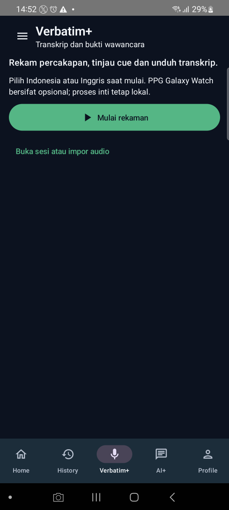
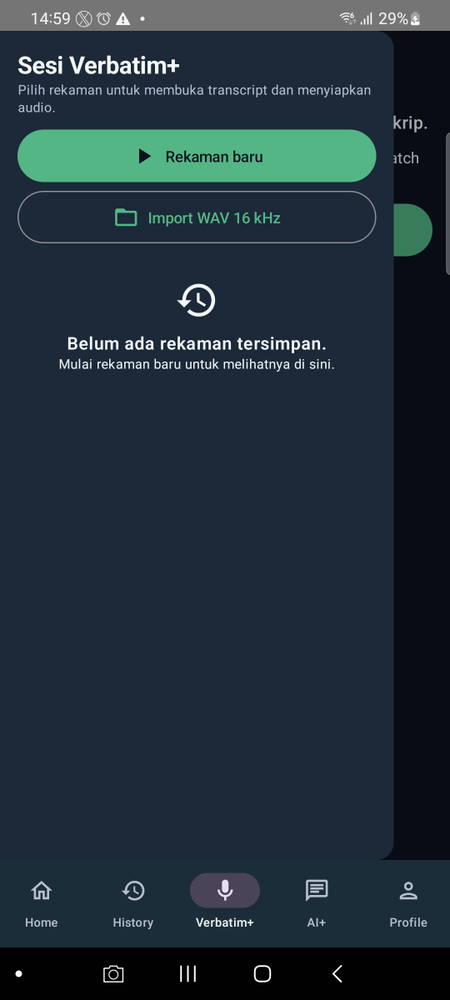
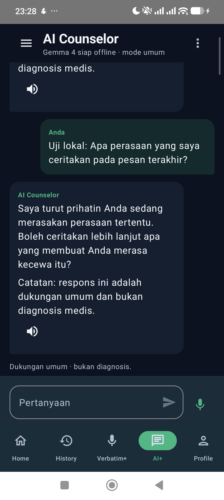
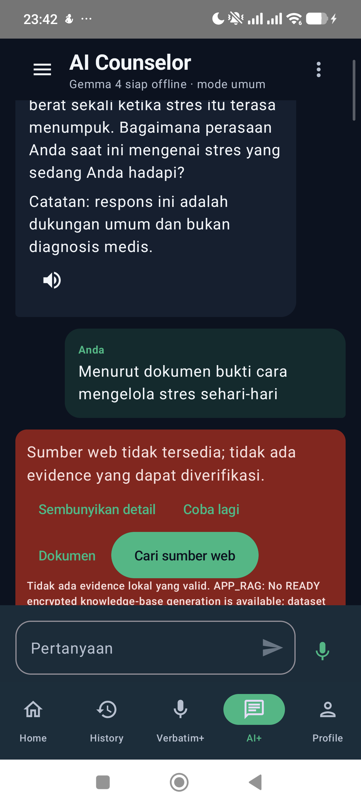
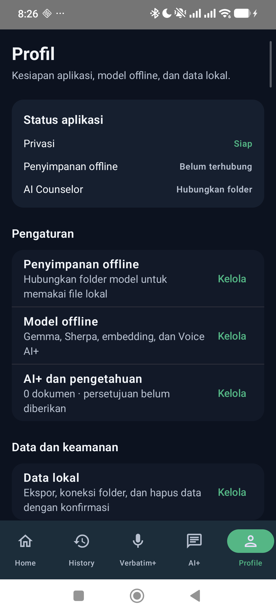

# Stress Detector — Android dan Wear OS

Aplikasi pendamping untuk merekam PPG dari Galaxy Watch dan menjalankan analisis lokal di Android. Hasilnya adalah dukungan keputusan untuk ditinjau, bukan diagnosis, alat klinis tervalidasi, atau pendeteksi kebohongan.

[Unduh Phone v0.1.5](https://github.com/Adrian463588/android-stress-detection/releases/download/android-v0.1.5/app-production-debug.apk) · [Unduh Watch v0.1.1](https://github.com/Adrian463588/android-stress-detection/releases/download/android-v0.1.5/wear-production-debug.apk) · [Semua rilis](https://github.com/Adrian463588/android-stress-detection/releases)

> **Status distribusi:** Phone v0.1.5 adalah prerelease debug untuk evaluasi internal, bukan rilis Play Store. Repository privat; unduhan memerlukan akun GitHub dengan akses. Watch v0.1.1 adalah companion terbaru dan tidak berubah pada rilis Phone v0.1.5.

## Ringkasan proyek

Phone menjadi pusat UI, pemrosesan, hasil, riwayat, AI+, dan Verbatim+. Watch menyediakan pengukuran PPG aktual. Model stres di Android memakai satu kanal PPG per model; ECG hanya digunakan sebagai referensi validasi pada pipeline penelitian, bukan input model aplikasi.

Model yang dikemas dikunci ke run **20260916T132736Z**. Green dan IR dievaluasi terpisah; Red hanya diagnostik. Jika data atau kualitas sinyal tidak cukup, aplikasi harus abstain alih-alih mengarang nilai atau hasil.

## Unduhan terbaru

| Aplikasi | Versi | Package | SHA-256 | Unduhan |
| --- | --- | --- | --- | --- |
| Phone | 0.1.5 · versionCode 6 | com.stressdetector | 073531f002e8f9a41fd600a0629b43916331c0bac0ccb68cff7abafae9f838d3 | [APK](https://github.com/Adrian463588/android-stress-detection/releases/download/android-v0.1.5/app-production-debug.apk) |
| Watch | 0.1.1 · versionCode 2 | com.stressdetector | 3ea5fd86c13105244350eab8ea7713cc793df0fbde8d1ba626f3b09a8bc8cf96 | [APK](https://github.com/Adrian463588/android-stress-detection/releases/download/android-v0.1.5/wear-production-debug.apk) |

- [Catatan rilis v0.1.5](docs/releases/android-v0.1.5.md)
- [File checksum rilis](https://github.com/Adrian463588/android-stress-detection/releases/download/android-v0.1.5/SHA256SUMS-0.1.5.txt)
- [Halaman rilis v0.1.5](https://github.com/Adrian463588/android-stress-detection/releases/tag/android-v0.1.5)

Angka checksum di atas dibandingkan dengan digest aset GitHub pada 18 Oktober 2026. Repository privat berarti pengunduh tanpa akses tidak dapat mengambil APK.

### Riwayat versi

| Tag | Phone | Watch | Status |
| --- | --- | --- | --- |
| [android-v0.1.5](https://github.com/Adrian463588/android-stress-detection/releases/tag/android-v0.1.5) | 0.1.5 | 0.1.1 | Prerelease terbaru; internal debug |
| [android-v0.1.2](https://github.com/Adrian463588/android-stress-detection/releases/tag/android-v0.1.2) | 0.1.2 | 0.1.1 | Historis |
| [android-v0.1.1](https://github.com/Adrian463588/android-stress-detection/releases/tag/android-v0.1.1) | 0.1.1 | 0.1.0 | Historis |
| [android-v0.1.0](https://github.com/Adrian463588/android-stress-detection/releases/tag/android-v0.1.0) | 0.1.0 | 0.1.0 | Rilis non-prerelease yang ditandai GitHub sebagai “Latest” |

GitHub masih menandai v0.1.0 sebagai rilis non-prerelease terbaru karena v0.1.5 ditandai prerelease. v0.1.5 tetap APK aplikasi terbaru yang tersedia di repo.

### Instalasi/update

Unduh APK Phone dan Watch dari pasangan di atas. Update APK Phone pada perangkat yang sama tanpa menghapus data:

    adb -s <serial-phone> install -r -d app-production-debug.apk

Gunakan serial yang benar-benar tampil pada `adb devices -l`:

```powershell
$phoneSerial = Read-Host 'Serial ADB Phone'
$watchSerial = Read-Host 'Serial ADB Watch'
adb -s $phoneSerial install -r -d .\app-production-debug.apk
adb -s $watchSerial install -r -d .\wear-production-debug.apk
```

Opsi tersebut memasang ulang secara in-place. Jangan menjalankan uninstall atau pm clear sebagai langkah update. Kedua perangkat harus memakai package dan signing identity yang kompatibel agar Wear Data Layer dapat berkomunikasi.

## Fitur aplikasi

| Menu | Fungsi | Batas bukti terbaru |
| --- | --- | --- |
| **Home** | Memeriksa kesiapan model, izin, dan reachability Watch; merekam sesi stress 5 menit; menampilkan hasil dan kualitas Green/IR. | Paket v0.1.5 lolos 868 JVM tests dan gate build/lint yang tercatat. Replay lulus untuk 7 window Green dan 7 IR. Pada satu sesi baru, Green menghasilkan Normal dan IR abstain karena gap. Full-channel acceptance masih NO_GO karena konflik timestamp diagnostik Red. |
| **History** | Meninjau sesi tersimpan, hasil, kualitas, grafik, serta detail provenance. | Screenshot detail yang ada berasal dari uji Xiaomi pada 3 Oktober, bukan bukti UI v0.1.5. |
| **Verbatim+** | Merekam dan meninjau audio/transkrip/marker; PPG Watch dapat menjadi konteks sesi bila tersedia. Audio tetap harus menunjukkan statusnya sendiri ketika Watch tidak tersedia. | Screenshot portrait/drawer yang tercatat berasal dari Samsung S20 pada 6 Oktober. Perekaman audio, STT, dan sinkronisasi Watch belum dinyatakan lolos end-to-end untuk rilis Phone v0.1.5. |
| **AI+** | Counselor lokal Gemma, retrieval dokumen, sitasi, dan pencarian web setelah persetujuan/opt-in yang sesuai. | Uji lokal dan jalur consent/recovery terdokumentasi. Corpus bawaan belum tervalidasi; percobaan web 5 Oktober berakhir unavailable. Jawaban web grounded yang berhasil belum dibuktikan pada evidence rilis. |
| **Profile** | Mengelola izin, model/bundle offline, storage, backup, serta pengaturan terkait. | Tersedia screenshot historis Xiaomi. Verifikasi lengkap semua operasi Profile pada build v0.1.5 belum diklaim. |

Semua hasil tetap bersifat non-diagnostik. Hasil Stress atau Normal adalah keluaran model pada data sesi tertentu, bukan pengukuran langsung atas perasaan pengguna atau validasi klinis. Green/IR tidak digabung atau dirata-ratakan. Akselerometer dapat digunakan untuk anotasi MADC per window jika sampel Watch aktual tersedia; data gerak bukan fitur model dan tidak memperbaiki waveform.

## Alur pengguna

~~~mermaid
flowchart TD
    A[Home] --> B{Izin, model, dan Watch siap?}
    B -- Tidak --> C[Perbaiki prasyarat / coba koneksi]
    C --> B
    B -- Ya --> D[Rekam PPG aktual selama 5 menit]
    D --> E[Validasi transport, SQA, dan preprocessing]
    E --> F{Window valid tersedia?}
    F -- Tidak --> G[INSUFFICIENT_SIGNAL]
    F -- Ya --> H[Inferensi ONNX Green dan IR secara terpisah]
    H --> I[Hasil aktual dan kualitas]
    G --> J[Simpan / tinjau di History]
    I --> J
    A --> K[Verbatim+ audio dan transkrip]
    A --> L[AI+ lokal / dokumen / web berizin]
    A --> M[Profile, model, izin, dan data]
~~~

## Stack dan arsitektur

- **Bahasa dan UI:** Kotlin, Jetpack Compose, Material 3.
- **Pola aplikasi:** MVVM, ViewModel, coroutines/Flow, unidirectional data flow.
- **Penyimpanan lokal:** Room dan penyimpanan terlindungi sesuai kontrak fitur.
- **Wear:** Wear OS, Google Play Services Wear Data Layer, Samsung Health Sensor SDK.
- **Biosignal:** preprocessing dan SQA/MADC; ONNX Runtime untuk inferensi lokal.
- **AI+:** Gemma lokal/LiteRT-LM, retrieval dokumen lokal, serta gateway web yang terikat consent.
- **Audio:** pemrosesan native untuk fitur akustik dan pipeline speech sesuai artifact/runtime yang tersedia.
- **Build:** Gradle, Android Gradle Plugin, JDK 17.

Batas utama: model stres Android menggunakan PPG. ECG, identitas, metadata sesi, dan kanal saudara tidak menjadi predictor. Data sintetis, fake status, citation buatan, dan prediksi saat sinyal tidak memadai dilarang.

## Struktur repository

    .
    ├── app/          # Aplikasi Phone, Compose UI, ViewModel, penyimpanan dan koordinasi
    ├── wear/         # Aplikasi Watch, sensor dan pengiriman batch PPG
    ├── shared/       # Kontrak pesan dan model data Phone–Watch
    ├── inference/    # Kontrak model, preprocessing dan ONNX runtime
    ├── config/       # Konfigurasi build/pipeline yang digunakan repo ini
    ├── docs/         # Panduan perangkat, release notes, screenshot dan evidence
    ├── gradle/       # Gradle wrapper dan konfigurasi
    ├── build.gradle
    └── settings.gradle

## Galeri UI perangkat

Gambar di bawah adalah tangkapan layar perangkat yang sudah tersimpan sebagai evidence di repo. Gambar tersebut **bukan screenshot build v0.1.5**. Xiaomi POCO X7 Pro (2412DPC0AG) dan package v0.1.5 sempat terdeteksi terpasang pada 18 Oktober 2026, tetapi perangkat terlepas dari ADB sebelum screenshot baru dan smoke test menu dapat diambil. Screenshot Verbatim+ yang tersedia berasal dari perangkat Samsung S20, bukan Xiaomi.

<details>
<summary>Home — Xiaomi, evidence 4 Oktober 2026 (build sebelumnya)</summary>


Gambar ini adalah bukti visual historis untuk hasil dan grafik sesi, bukan screenshot v0.1.5. Gambar saja tidak membuktikan input model, hasil inferensi, atau validasi klinis; gunakan receipt yang sesuai sebelum menafsirkan hasil.

</details>

<details>
<summary>History — Xiaomi, evidence 3 Oktober 2026 (build sebelumnya)</summary>


</details>

<details>
<summary>Verbatim+ — Samsung S20, evidence 6 Oktober 2026</summary>





Ini bukan screenshot Xiaomi dan bukan penerimaan perekaman audio pada v0.1.5. [Catatan perangkat Verbatim+](docs/verbatim-device-acceptance-20261006.md).

</details>

<details>
<summary>AI+ — Xiaomi, evidence 5 Oktober 2026 (build sebelumnya)</summary>





Gambar memperlihatkan smoke test yang disetujui. Jalur web tidak menghasilkan evidence tervalidasi; lihat [receipt AI+](docs/evidence/ai-plus-20261005/acceptance.md).

</details>

<details>
<summary>Profile — screenshot Xiaomi historis; tanggal/build capture tidak terverifikasi</summary>



</details>

## Status verifikasi dan batas penerimaan

| Area | Bukti yang tersedia | Status |
| --- | --- | --- |
| Unit test Phone/Inference/Shared | 796 + 34 + 38 = 868 JVM tests, tanpa failure/error/skip pada verification receipt v0.1.5. | Lulus pada scope tersebut |
| Static checks dan APK Phone | ktlintCheck, detekt, app/inference production lint, dan assembleProductionDebug dilaporkan lulus. | Lulus pada scope tersebut |
| Watch module pada checkout v0.1.5 | Samsung Health Sensor SDK AAR tidak tersedia; Watch test/compile tidak diklaim lulus di checkout itu. | Belum diverifikasi |
| Instalasi Xiaomi | Pada 18 Oktober, ADB melihat model 2412DPC0AG dan package com.stressdetector v0.1.5/versionCode 6. Xiaomi terlepas sebelum screenshot dan menu smoke test. | Versi terpasang terverifikasi; UI smoke tertunda |
| PPG dan prediksi | Replay satu rekaman lulus 7 window Green + 7 IR. Satu sesi langsung: Green Normal, IR insufficient signal. Red timestamp conflict membuat full-channel acceptance NO_GO. | Partial; bukan validasi klinis |
| AI+ | Local Gemma serta consent/unavailable recovery punya evidence. Web test tidak berhasil mengambil evidence valid; bundled knowledge corpus belum lulus benchmark. | Partial; grounded-web acceptance belum lulus |
| Verbatim+ | UI smoke non-recording pada Samsung dan screenshot tersedia. | Audio/STT/Watch end-to-end terbaru belum diklaim |
| Profile dan backup | Tangkapan layar serta sebagian smoke non-recording historis tersedia. | Semua operasi belum diverifikasi pada v0.1.5 |

**Kesimpulan:** repo ini belum memiliki bukti yang mendukung klaim “semua fitur telah lolos end-to-end pada v0.1.5”. Status yang belum lulus atau belum diuji ditampilkan terbuka agar README tidak menjadi klaim pemasaran yang menyesatkan.

- [Catatan rilis v0.1.5](docs/releases/android-v0.1.5.md)
- [Panduan uji perangkat](docs/device-test-guide.md)
- [Evidence AI+](docs/evidence/ai-plus-20261005/acceptance.md)
- [Evidence Verbatim+](docs/verbatim-device-acceptance-20261006.md)

## Build dan pengujian

Persyaratan: JDK 17, Android SDK, Gradle wrapper repository, model index dan detector contract dari run 20260916T132736Z, serta Samsung Health Sensor SDK 1.4.1 lokal untuk modul Watch. AAR Samsung tidak disimpan di Git. Distribusi aplikasi yang memakai SDK Samsung memerlukan persetujuan partner Samsung; baca [ketentuan resmi Developer Mode](https://developer.samsung.com/health/sensor/guide/developer-mode.html).

Packaging Phone memerlukan artifact kanonik dari checkout ProsesData yang sesuai. Tanpa index, detector contract, model, atau SDK yang diwajibkan, build harus berhenti dengan jelas; jangan mengganti dependency itu dengan dummy.

Jalankan test dari root repository setelah menyediakan artifact dari run yang
dikunci. Masukkan path root run yang benar-benar ada; script menolak run lain
atau file kontrak yang tidak tersedia:

```powershell
$runRoot = (Resolve-Path -LiteralPath (Read-Host 'Path folder run 20260916T132736Z')).Path
if ((Split-Path -Leaf $runRoot) -ne '20260916T132736Z') {
    throw 'Model production dikunci ke run 20260916T132736Z.'
}
$internalModelIndex = Join-Path $runRoot 'export\internal\internal_model_index.json'
$detectorContract = Join-Path $runRoot 'export\internal\ppg_detector_contract.json'
if (!(Test-Path -LiteralPath $internalModelIndex) -or !(Test-Path -LiteralPath $detectorContract)) {
    throw 'Model index atau detector contract tidak ditemukan pada run yang dipilih.'
}
.\gradlew.bat "-PinternalModelIndex=$internalModelIndex" "-PdetectorContract=$detectorContract" :shared:test :inference:testProductionDebugUnitTest :app:testProductionDebugUnitTest
```

Wear compile/test dan semua pemeriksaan lain harus dicatat terpisah sesuai dependency lokal yang tersedia. Perintah test yang sukses tidak membuktikan sensor fisik, microphone, RAG faithfulness, reminder delivery, atau validasi klinis.

## BDD dan perubahan berbasis spesifikasi

Untuk perubahan produk/dokumentasi, definisikan perilaku yang dapat diperiksa dengan skenario Given/When/Then, implementasikan perubahan terkecil, lalu simpan hasil verifikasi dan batas klaim. Kontrak perubahan README ini dan skenario acceptance ada di [spec README refresh](docs/specs/spec-readme-refresh/SPEC.md).

Referensi workflow:

- [BDD dan contoh Gherkin — Cucumber](https://github.com/cucumber/docs/blob/main/content/docs/guides/overview.md)
- [BMAD Method](https://github.com/bmad-code-org/BMAD-METHOD)
- [OpenSpec SDD](https://github.com/Fission-AI/OpenSpec)
- [RTK — panduan authoring](https://github.com/rtk-ai/rtk)
- [CAVEMAN — panduan authoring](https://github.com/JuliusBrussee/caveman)
- [PONYTAIL — panduan authoring](https://github.com/dietrichgebert/ponytail)

RTK, CAVEMAN, dan PONYTAIL berfungsi sebagai panduan authoring/quality pada repo ini, bukan dependency runtime Android.

## Checklist README

- [x] Overview, batas non-diagnostik, dan model run dijelaskan.
- [x] APK Phone/Watch terbaru, versi, package, checksum, serta riwayat rilis ditautkan.
- [x] Lima menu, fungsi, alur pengguna Mermaid, stack, dan struktur modul diringkas.
- [x] Screenshot nyata yang sudah tersimpan dipakai dengan perangkat, tanggal, dan batas versinya.
- [x] Hasil test dan gap fitur dibedakan; tidak ada klaim semua fitur telah lolos E2E.
- [x] BDD/BMAD/OpenSpec-style acceptance dan sumber GitHub dicatat.
- [ ] Screenshot segar dan smoke test semua menu pada Xiaomi v0.1.5 — tertunda: Xiaomi terputus dari ADB sebelum pengambilan.
